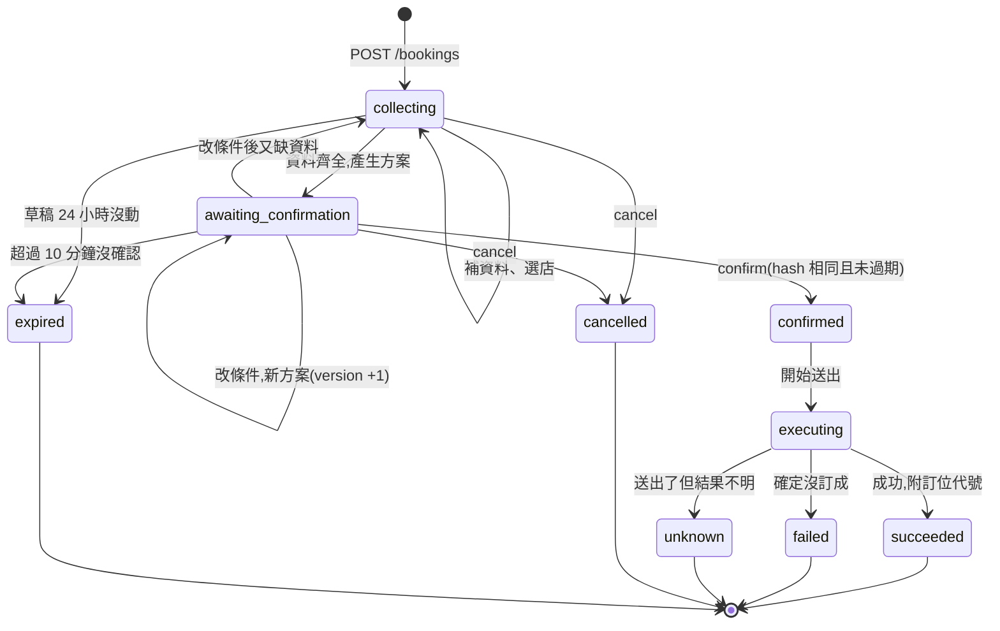
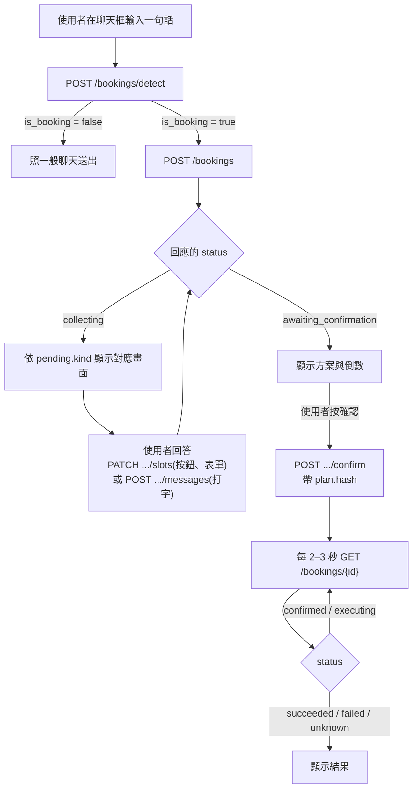
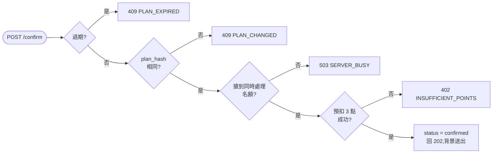

# 訂位代辦 API (`/v1/bookings`)

通則(認證、錯誤格式、限流)見 [`API.md`](API.md#通則),設計理由見 [`../booking/DECISIONS.md`](../booking/DECISIONS.md)。

所有端點都要 `Authorization: Bearer <token>`。寫入類(POST / PATCH)每位使用者 30 次/分鐘。

## 目錄
- [概念與狀態](#概念與狀態)
- [客戶端怎麼用](#客戶端怎麼用)
- [端點](#端點)
- [待回答的問題 pending](#待回答的問題-pending)
- [點數](#點數)
- [錯誤碼](#錯誤碼)

---

## 概念與狀態

一筆「訂位需求」從使用者的一句話開始,系統一步步補齊資料、整理出**方案**,使用者**確認**後才會真的向店家送出。狀態都存在伺服器,使用者可以隨時離開、之後再回來查。



| 狀態 | 意義 | 使用者能做什麼 |
|---|---|---|
| `collecting` | 補資料中,`pending` 說明在等什麼 | 回答、選店、取消 |
| `awaiting_confirmation` | 方案已產生,等確認(`plan.expires_at` 是期限) | 確認、修改條件、取消 |
| `confirmed` / `executing` | 已確認,正在送出 | 查進度。**不能取消** |
| `succeeded` | 訂位成功,`result.confirmation_no` 是訂位代號 | — |
| `failed` | 沒訂成(客滿、公休…),`result.message` 說明原因。**確定沒有訂位存在** | 重新建立 |
| `unknown` | **結果不明**:請求可能已送達店家,但沒收到明確回覆。系統**不會自動重送**(避免重複訂位),也不扣點 | 直接聯絡店家確認 |
| `expired` | 方案超過 10 分鐘沒確認,或草稿 24 小時沒動 | 重新建立 |
| `cancelled` | 使用者取消 | — |

---

## 客戶端怎麼用



使用者離開再回來:用 `GET /bookings?view=...` 找回進行中與歷史的訂位,再 `GET /bookings/{id}` 還原畫面。

兩個重點:
- **按鈕與表單用 `PATCH .../slots`**(不經 AI、不扣點);使用者**打字**才用 `POST .../messages`(經 AI 理解、扣點)。
- 在對話框打「確認」**不會**送出訂位。送出只能透過 `confirm`,而且必須帶上畫面上方案的 `hash`。

---

## 端點

### `POST /bookings/detect`

判斷一句話是不是訂位需求。純規則,不呼叫模型、不扣點。

```json
{ "text": "幫我訂週五晚上 7 點 4 個人 Jump" }
```
```json
{ "is_booking": true }
```

### `POST /bookings`

建立需求並處理第一輪。**扣 1 點**(AI 理解),失敗不扣。

| 欄位 | 說明 |
|---|---|
| `text` | 必填,使用者的話,≤ 500 字 |
| `client_request_id` | 選填,冪等鍵。網路中斷後用同一個重送,會回傳同一筆(200),不會重複建立或扣點 |

回 `201`,內容與 `GET /bookings/{id}` 相同。範例(節錄):

```json
{
  "id": "919e5e68-794f-4071-b681-80cf1dc5af11",
  "status": "collecting",
  "slots": { "date": "2026-11-13", "time": "19:00", "party_size": 4 },
  "pending": {
    "kind": "provide_info",
    "fields": [
      { "key": "contact.name",  "type": "text",   "label": "訂位姓名" },
      { "key": "contact.phone", "type": "tel",    "label": "台灣手機（09xxxxxxxx）" },
      { "key": "contact.email", "type": "email",  "label": "電子郵件" },
      { "key": "extra.title",   "type": "select", "label": "稱謂", "options": ["先生", "小姐"] }
    ]
  },
  "plan": null,
  "result": null
}
```

可能的錯誤:不是訂位需求 `422`;進行中的草稿已有 5 筆 `409 TOO_MANY_ACTIVE`。

### `PATCH /bookings/{id}/slots`

結構化輸入(按鈕、表單)。**不經 AI、不扣點**。至少要有一個欄位。

| 欄位 | 說明 |
|---|---|
| `restaurant_id` | 從 `pending.options` 選一家,**只接受候選清單內的店** |
| `party_size` | 人數,1–50 |
| `date` / `time` | `YYYY-MM-DD` / `HH:MM` |
| `contact` | `{ name, phone, email }`,電話格式不符回 `400` |
| `extra` | 店家額外的必填欄位,key 是 `pending.fields[].key` 去掉 `extra.` 前綴 |
| `notes` | 備註 |
| `client_msg_id` | 選填,冪等鍵 |

資料齊全時,回傳會變成等待確認,並附上方案:

```json
{
  "status": "awaiting_confirmation",
  "pending": { "kind": "confirm_plan" },
  "plan": {
    "restaurant": { "id": "joymap-jump888", "name": "TEST01：Jump！Jump！", "address": "新北市淡水區大忠街", "phone": "027777777" },
    "date": "2026-11-13", "time": "19:00", "party_size": 4,
    "contact": { "name": "王小明", "phone": "0912345678", "email": "ming@example.com" },
    "extra": { "title": "先生", "purpose": "朋友聚餐" },
    "hash": "0c387f9341b5b93f67e9cf7d",
    "version": 1,
    "expires_at": "2026-11-08T07:54:08.787Z",
    "can_confirm": true
  }
}
```

方案確認前使用者改了條件,會產生**新方案**:`version` +1、`hash` 改變、期限重算,舊方案作廢。

### `POST /bookings/{id}/messages`

用自然語言回答或修改條件,例如「我叫王小明,電話 0912-345-678」「改成 8 點」。**扣 1 點**,失敗不扣。

| 欄位 | 說明 |
|---|---|
| `text` | 必填,≤ 500 字 |
| `client_msg_id` | 選填,冪等鍵。同一個重送只處理一次、不重複扣點 |

同一筆需求同時只處理一個操作,並發的第二個回 `409 TURN_IN_PROGRESS`,稍後重試即可。

### `POST /bookings/{id}/confirm`

確認方案並開始送出。成功回 **`202`**,實際送出在背景進行,用 `GET` 查進度。

```json
{ "plan_hash": "0c387f9341b5b93f67e9cf7d" }
```

**確認什麼就只能送出什麼**:`plan_hash` 必須等於伺服器目前的方案,否則 `409 PLAN_CHANGED`(回應附最新方案,客戶端應重新顯示給使用者看)。

確認時依序做下面幾步。**任何一步失敗,狀態和點數都維持原樣**,可以直接重試;重送同一份確認是冪等的,不會重複執行。



結束後 `GET` 會看到:

```json
{ "status": "succeeded", "result": { "ok": true, "confirmation_no": "…" } }
```
```json
{ "status": "failed", "result": { "ok": false, "code": "SLOT_UNAVAILABLE", "message": "…" } }
```
```json
{ "status": "unknown", "result": { "ok": false, "code": "RESULT_UNKNOWN", "message": "訂位已送出,但沒有收到店家的明確回覆…請直接聯絡店家確認。" } }
```

### `GET /bookings`

列出我的訂位,依「接下來要做什麼」分組。

| `view` | 內容 |
|---|---|
| `attention` | 需要處理:結果不明且用餐日還沒過、等你確認的方案 |
| `upcoming` | 即將到來:訂位成功且用餐日 ≥ 今天,依日期時間排序 |
| `in_progress` | 進行中:補資料中、已確認、正在訂位 |
| `history` | 訂位紀錄:所有已結束的,依結束時間新到舊 |

`history` 另有三個參數:`result`(`succeeded` / `failed` / `unknown` / `cancelled` / `expired`)篩選、`before`(上一頁回應的 `next_before`)翻頁、`limit`(1–100,預設 30)。

每筆含 `status`、`summary`、`restaurant`、`date`、`time`、`party_size`、`result`;`awaiting_confirmation` 的另有 `expires_at` 可做倒數。

### `GET /bookings/{id}`

完整狀態:`status`、`pending`、`slots`、`plan`、`confirmed_plan`、`result`、`events`(對話與進度紀錄,依序顯示即可還原畫面)、`charges`(這筆需求的每一次扣點與狀態)。別人的需求回 `404`。

### `POST /bookings/{id}/cancel`

取消。只有 `collecting` / `awaiting_confirmation` 可以取消;已確認的請求可能已離開系統,回 `409 CANNOT_CANCEL`。重複取消是冪等的。

---

## 待回答的問題 `pending`

`pending.kind` 告訴客戶端「現在在等使用者做什麼」,終止狀態時為 `null`。

| `kind` | 該顯示 | 回答方式 |
|---|---|---|
| `provide_request` | 問使用者想訂哪一家,或地區與料理類型 | `messages` |
| `choose_restaurant` | 候選店家列表(`options[]`) | `slots.restaurant_id`,或 `messages`(「第二家」) |
| `provide_slots` | 人數或日期選項。**一次只問一項**,順序為人數 → 日期 | `slots` |
| `choose_time` | 可選時段(`options[]`)。人數與日期都確定後才出現 | `slots.time` |
| `provide_info` | 聯絡資料表單(`fields[]`,type 有 `text` `tel` `email` `select`),欄位由店家決定 | `slots.contact` / `slots.extra` |
| `confirm_plan` | 方案 + 倒數 + 確認按鈕 | `confirm` |

---

## 點數

| 動作 | 點數 | 說明 |
|---|---|---|
| AI 理解(建立、`messages`) | **1 點** | 該輪成功處理後結算,失敗不扣 |
| 訂位(`confirm`) | **3 點** | **訂位成功才扣**;失敗、結果不明、客滿都不扣 |
| 結構化輸入(`slots`)、取消、查詢 | 0 | |

- 每次扣點都在 `GET /points/ledger`(使用者)與後台(客服),`ref_type` 為 `booking_turn` / `booking`,`meta.booking_id` 可對回需求。
- 流程是「預扣 → 結算 / 釋放」,與聊天相同:開始前先確定夠不夠(不夠回 `402`,什麼都不會發生)。`charges[].state` 可看每一筆走到哪裡(`held` 預扣中 → `settled` 已扣 / `released` 已退還)。
- 數值可用環境變數 `COST_TURN`、`COST_BOOK` 調整。

---

## 錯誤碼

格式同[通則](API.md#錯誤格式)。

| HTTP | `code` | 說明 | 客戶端建議 |
|---|---|---|---|
| 400 | `INVALID_REQUEST` | 參數錯誤(電話、日期格式…) | 修正後重送 |
| 400 | `INVALID_CHOICE` | 選的店不在候選清單 | 重新取得狀態 |
| 402 | `INSUFFICIENT_POINTS` | 點數不足,附 `required` / `balance` / `available` | 引導儲值,補點後可直接再確認 |
| 409 | `PLAN_CHANGED` | 方案已更新,`error.current` 是最新方案 | 重新顯示方案 |
| 409 | `PLAN_EXPIRED` | 方案已過期 | 重新建立 |
| 409 | `CANNOT_CANCEL` | 已送出處理,不能取消 | 提示聯絡店家 |
| 409 | `TURN_IN_PROGRESS` | 上一個操作還在處理 | 稍後重試 |
| 409 | `TOO_MANY_ACTIVE` | 進行中的草稿太多(上限 5) | 先完成或取消 |
| 422 | `NOT_BOOKING_INTENT` | 不是訂位需求 | 當作一般聊天 |
| 429 | `RATE_LIMITED` | 太頻繁 | 依 `retry_after` |
| 503 | `SERVER_BUSY` | 同時處理訂位的人數已滿(預設 3),帶 `retry_after`。**沒改變任何東西、沒扣點** | 等待後重試 |
| 503 | `CHANNEL_UNAVAILABLE` | 暫時查不到店家規則 | 稍後重試(不扣點) |

`SERVER_BUSY` 的實際回應:

```json
{ "error": { "code": "SERVER_BUSY", "message": "目前同時處理訂位的人數已滿,請稍後再試", "retry_after": 10 } }
```
