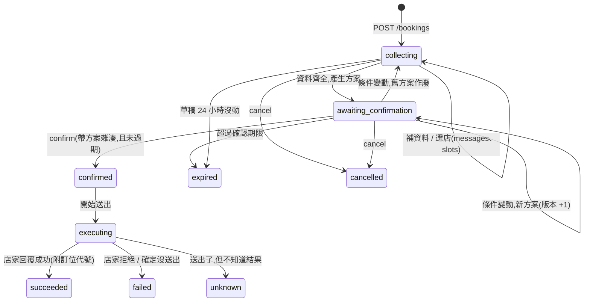

# 訂位代辦 API 文件(`/v1/bookings`)

> 範例回應都是對實際運行的系統呼叫後取得的(僅縮短過長的陣列、把 UUID 與時間保留原樣)。
> 通則(認證、錯誤格式、限流)與聊天 API 相同,見 [`API.md`](API.md#通則)。設計理由與取捨見 [`../booking/DECISIONS.md`](../booking/DECISIONS.md)。

## 目錄
- [概念](#概念)
- [建議的客戶端流程](#建議的客戶端流程)
- [端點](#端點)
- [待回答的問題 `pending`](#待回答的問題-pending)
- [點數](#點數)
- [錯誤碼](#錯誤碼)

---

## 概念

一筆「訂位需求」(booking)從使用者的一句話開始,系統一步步補齊資料、整理出**方案**,使用者**確認**後才會真的向店家送出。整個過程的狀態都存在伺服器,使用者可以隨時離開、之後用任何方式回來查。



| `status` | 意義 | 使用者能做什麼 |
|---|---|---|
| `collecting` | 還在補資料(`pending` 說明在等什麼) | 回答、選店、取消 |
| `awaiting_confirmation` | 方案已產生,等使用者確認(`plan`、`plan.expires_at`) | 確認、修改條件、取消 |
| `confirmed` / `executing` | 已確認,正在向店家送出 | 查進度。**不能取消**(請求可能已離開系統) |
| `succeeded` | 訂位成功,`result.confirmation_no` 是訂位代號 | |
| `failed` | 沒有訂成(店家客滿、公休…),`result.code` / `message` 說明原因。**確定沒有訂位存在** | 重新建立 |
| `unknown` | **結果不明**:請求可能已送達店家,但沒收到明確回覆。系統**不會自動重送**(避免重複訂位),也不扣點 | 直接聯絡店家確認 |
| `expired` | 確認期限已過(預設 10 分鐘)或草稿太久沒動(24 小時) | 重新建立 |
| `cancelled` | 使用者取消 | |

## 建議的客戶端流程

```
使用者在聊天框輸入一句話
 │
 ├─ POST /bookings/detect  {text}            免費、純規則、毫秒完成
 │     └─ is_booking=false → 照一般聊天送出(POST /conversations/{id}/messages)
 │
 └─ is_booking=true → POST /bookings {text, client_request_id}
       ├─ pending.kind = choose_restaurant → 顯示候選店,使用者點選 → PATCH /bookings/{id}/slots {restaurant_id}
       ├─ pending.kind = provide_info      → 顯示表單(依 fields),送出     → PATCH /bookings/{id}/slots {contact, extra}
       ├─ pending.kind = choose_time       → 顯示可選時段                   → PATCH /bookings/{id}/slots {time}
       ├─ pending.kind = provide_slots     → 問日期 / 時間 / 人數            → PATCH 或 POST .../messages
       └─ status = awaiting_confirmation   → 顯示方案(plan)與倒數(plan.expires_at)
             └─ 使用者按確認 → POST /bookings/{id}/confirm {plan_hash: plan.hash}   → 202
                   └─ 每 2~3 秒 GET /bookings/{id},直到 status 是 succeeded / failed / unknown

使用者離開 App 再回來:GET /bookings?status=active 找進行中的需求 → GET /bookings/{id} 還原畫面
```

- **按鈕 / 表單用 `PATCH .../slots`(結構化輸入,不經過 AI,不扣點)**;使用者打字用 `POST .../messages`(經過 AI 理解,扣點)。
- 在對話框裡打「確認」**不會**送出訂位。送出只能透過 `confirm`,而且必須帶上畫面上方案的 `hash`。

---

## 端點

所有端點都需要 `Authorization: Bearer <token>`。寫入類(POST / PATCH)每位使用者 30 次/分鐘(`429 RATE_LIMITED`)。

### `POST /v1/bookings/detect`

判斷一句話是不是訂位需求。**純規則,不呼叫模型、不扣點**,一般聊天不會因此多花錢。取向是寧可漏判也不要誤判。

```json
{ "text": "幫我訂這週五晚上 7 點，4 個人，信義區的日式料理" }
```
```json
{ "is_booking": true }
```

### `POST /v1/bookings`

建立訂位需求並處理第一輪。**扣 1 點**(AI 理解需求)。

| 欄位 | 型別 | 說明 |
|---|---|---|
| `text` | string,必填 | 使用者的話,≤ 500 字 |
| `client_request_id` | string,選填 | 冪等鍵。網路中斷後用同一個重送,會回傳同一筆(200),不會重複建立、重複扣點 |

不是訂位需求 → `422 NOT_BOOKING_INTENT`(沒建立、沒扣點)。同時進行中的草稿上限 5 筆(`409 TOO_MANY_ACTIVE`)。

**回應 `201`**(節錄;`pending.options` 實際有 4 家,`events` 只留第一筆):

```json
{
  "id": "919e5e68-794f-4071-b681-80cf1dc5af11",
  "status": "collecting",
  "summary": "信義區日式 · 2026-11-13 19:00 · 4 位",
  "pending": {
    "kind": "choose_restaurant",
    "options": [
      { "id": "r_hinoki", "name": "檜木割烹", "district": "信義區", "cuisine": "日式", "rating": 4.8,
        "address": "台北市信義區松高路 19 號", "phone": "02-2720-0002", "booking": "web_form" },
      { "id": "r_kaisen", "name": "海膳壽司", "district": "信義區", "cuisine": "日式", "rating": 4.5,
        "address": "台北市信義區忠孝東路五段 68 號", "phone": "02-2720-0003", "booking": "platform_api" }
    ]
  },
  "slots": { "area": "信義區", "cuisine": "日式", "date": "2026-11-13", "time": "19:00", "party_size": 4 },
  "plan": null,
  "confirmed_plan": null,
  "result": null,
  "cost": { "per_message": 1, "on_success": 3 },
  "events": [
    { "id": 720, "type": "user", "text": "幫我訂這週五晚上 7 點，4 個人，信義區的日式料理", "data": {}, "at": "2026-11-08T07:44:08.612Z" },
    { "id": 721, "type": "assistant", "text": "幫你找到這幾家信義區日式、可以線上訂位的店,想訂哪一家?", "data": { "pending_kind": "choose_restaurant" }, "at": "2026-11-08T07:44:08.612Z" }
  ],
  "charges": [ { "kind": "turn", "amount": 1, "state": "settled", "note": "訂位代辦:AI 理解需求" } ]
}
```

- 候選店家**只列出搜尋得到訂位連結的店**。`booking` 是這家店的訂位管道(`web_form` 店家自己的訂位網頁 / `platform_api` 合作平台)。
- 使用者指定了店名時,會去搜尋該店有沒有訂位連結:找到就直接用(有多家分店則請使用者選);找得到店但**搜尋不到訂位連結**,會明說無法代訂並附上店家電話,同時列出同區可線上訂位的替代店家。
- `events` 是對話與進度紀錄,依序顯示即可還原畫面。`type`:`user` / `assistant` / `status`。

### `GET /v1/bookings`

列出我的訂位需求(最新更新的在前,進行中的排在最前面)。

| query | 說明 |
|---|---|
| `status` | `active`(只列進行中:補資料 / 待確認 / 送出中)或 `all`(預設) |
| `limit` | 1–100,預設 30 |

```json
{
  "items": [
    {
      "id": "32a61492-bd0a-4bef-b42e-f55667401059",
      "status": "succeeded",
      "summary": "夜行居酒屋 · 2026-11-13 20:00 · 4 位",
      "pending_kind": null,
      "expires_at": null,
      "result": { "ok": true, "confirmation_no": "WF-D15HPE" },
      "updated_at": "2026-11-08T08:05:21.307Z"
    }
  ]
}
```

`expires_at` 只有 `awaiting_confirmation` 才有值(確認期限,用來顯示倒數)。

### `GET /v1/bookings/{id}`

取得完整狀態:`status`、`pending`、`slots`、`plan`、`confirmed_plan`、`result`、`events`、`charges`(這筆需求的每一次扣點與它的狀態)。別人的需求回 `404`。

### `POST /v1/bookings/{id}/messages`

用自然語言回答或修改條件(例如「我叫王小明,電話 0912-345-678」「改成 8 點」「第二家」)。**扣 1 點**。

| 欄位 | 說明 |
|---|---|
| `text` | 必填,≤ 500 字 |
| `client_msg_id` | 選填,冪等鍵。同一個重送只處理一次、不重複扣點 |

- 同一筆需求同時只處理一個操作;並發的第二個回 `409 TURN_IN_PROGRESS`(可稍後重試)。
- 失敗(搜尋服務壞了、店家網頁讀不到…)不扣點,狀態不變,可直接重試。
- 方案確認前使用者改了條件,會產生**新方案**(`plan.version` +1、`plan.hash` 改變、期限重算),舊方案作廢。

### `PATCH /v1/bookings/{id}/slots`

結構化輸入(按鈕 / 表單)。**不經過 AI,不扣點。** 至少要有一個欄位。

| 欄位 | 說明 |
|---|---|
| `restaurant_id` | 從 `pending.options` 選一家。**只接受候選清單內的店**(`400 INVALID_CHOICE`) |
| `date` / `time` / `party_size` | `YYYY-MM-DD` / `HH:MM` / 1–50 |
| `contact` | `{ name, phone, email }`。電話格式不符 → `400` |
| `extra` | 店家額外的必填欄位,key 是 `pending.fields[].key` 去掉 `extra.` 前綴 |
| `notes` | 備註 |
| `client_msg_id` | 選填,冪等鍵 |

範例:選了「夜行居酒屋」後,系統問出這家店要的資料(每家店要的不一樣,這家多一個必填的下拉選單):

```json
{
  "status": "collecting",
  "pending": {
    "kind": "provide_info",
    "fields": [
      { "key": "contact.name",  "type": "text",   "label": "訂位姓名" },
      { "key": "contact.phone", "type": "tel",    "label": "聯絡電話" },
      { "key": "extra.seating", "type": "select", "label": "座位偏好", "options": ["吧台", "包廂"] }
    ]
  }
}
```

補齊後回傳 `status: "awaiting_confirmation"` 與方案:

```json
{
  "status": "awaiting_confirmation",
  "pending": { "kind": "confirm_plan" },
  "plan": {
    "restaurant": { "id": "r_izakaya", "name": "夜行居酒屋", "address": "台北市信義區松壽路 9 號", "phone": "02-2720-0004" },
    "target": { "channel": "web_form", "url": "http://booking-sim:9100/r/r_izakaya/reserve" },
    "date": "2026-11-13", "time": "19:00", "party_size": 4,
    "contact": { "name": "王小明", "phone": "0912345678" },
    "extra": { "seating": "包廂" },
    "hash": "0c387f9341b5b93f67e9cf7d",
    "version": 1,
    "expires_at": "2026-11-08T07:54:08.787Z",
    "can_confirm": true
  }
}
```

### `POST /v1/bookings/{id}/confirm`

確認方案並開始送出。成功回 **`202`**,實際送出是背景進行的,用 `GET` 查進度。

```json
{ "plan_hash": "e8c3dc14153604c60ee95dc0" }
```

**「確認了什麼就只能送出什麼」**:`plan_hash` 必須等於伺服器目前的方案,否則 `409 PLAN_CHANGED`(回應附上最新方案,客戶端應重新顯示給使用者看)。確認當下方案被複製成 `confirmed_plan` 並凍結,送出只讀這一份(連送到哪個網址 / 平台都包含在內)。

確認時依序發生:檢查是否過期 → 搶「同時處理」名額(滿了回繁忙) → 預扣訂位費(不足回 402) → 把狀態改為 `confirmed`。任何一步失敗,**狀態和點數都維持原樣**,可以直接重試。

- 重送同一份確認是冪等的(回傳目前進度,不會重複執行)。
- 確認後的 `GET`:

```json
{
  "status": "succeeded",
  "result": { "ok": true, "confirmation_no": "WF-D15HPE" },
  "confirmed_plan": { "restaurant": { "name": "夜行居酒屋" }, "date": "2026-11-13", "time": "20:00", "party_size": 4, "hash": "e8c3dc14153604c60ee95dc0", "confirmed_at": "2026-11-08T08:05:18.776Z" },
  "charges": [
    { "kind": "turn", "amount": 1, "state": "settled", "note": "訂位代辦:AI 理解需求" },
    { "kind": "turn", "amount": 1, "state": "settled", "note": "訂位代辦:AI 理解需求" },
    { "kind": "exec", "amount": 3, "state": "settled", "note": "訂位代辦:夜行居酒屋 2026-11-13 20:00 4 位" }
  ]
}
```

**結果不明**時(送出了,店家沒回應):

```json
{
  "status": "unknown",
  "result": { "ok": false, "code": "RESULT_UNKNOWN",
              "message": "訂位已送出,但沒有收到店家的明確回覆,無法確定有沒有訂成。為避免重複訂位,系統不會自動重送,這次也不會扣點。請直接聯絡店家確認。" },
  "charges": [ { "kind": "turn", "amount": 1, "state": "settled", "note": "訂位代辦:AI 理解需求" },
               { "kind": "exec", "amount": 3, "state": "released", "note": "訂位代辦:炭火燒肉屋 2026-11-13 19:00 2 位" } ]
}
```

### `POST /v1/bookings/{id}/cancel`

取消。只有 `collecting` / `awaiting_confirmation` 可以取消(已確認的訂位請求可能已經離開系統,`409 CANNOT_CANCEL`)。重複取消是冪等的。

---

## 待回答的問題 `pending`

`pending.kind` 告訴客戶端「現在在等使用者做什麼」,終止狀態時為 `null`。

| `kind` | 欄位 | 客戶端該顯示 | 回答方式 |
|---|---|---|---|
| `provide_request` | — | 問使用者想訂哪一家,或地區與料理類型 | `messages` |
| `choose_restaurant` | `options[]` | 候選店家(名稱、評分、地址、電話、訂位管道) | `slots.restaurant_id`,或 `messages`(「第二家」「櫻花亭」) |
| `provide_slots` | `fields[]`:`date` / `time` / `party_size` | 缺的項目 | `slots` 或 `messages` |
| `choose_time` | `options[]`(可訂的時段) | 時段選擇 | `slots.time` |
| `provide_info` | `fields[]`:`key` / `label` / `type`(`text` `tel` `email` `select`) / `options` | 表單,**欄位由店家決定**(有的只要電話,有的還要 email,有的多一個下拉選單) | `slots.contact` / `slots.extra` |
| `confirm_plan` | — | 方案 + 倒數 + 確認按鈕 | `confirm` |

## 點數

| 動作 | 點數 | 時機 |
|---|---|---|
| 每次 AI 理解(建立、`messages`) | **1 點** | 該輪成功處理後結算;失敗不扣 |
| 訂位(`confirm`) | **3 點** | **訂位成功才扣**。失敗、結果不明、店家客滿都不扣 |
| 結構化輸入(`slots`)、取消、查詢 | 0 | |

數值可用環境變數調整(`COST_TURN`、`COST_BOOK`)。每一次扣點都出現在 `GET /v1/points/ledger`(使用者)與後台(客服),`ref_type` 為 `booking_turn` / `booking`,`note` 說明用途,`meta.booking_id` 可對回訂位需求:

```json
{ "type": "charge", "amount": -3, "ref_type": "booking",
  "note": "訂位代辦:海膳壽司 2026-11-13 19:00 4 位",
  "meta": { "booking_id": "c2c95af8-a707-4c24-a6c6-43d6cdf0de14", "ref_type": "booking" } }
```

點數流程是「預扣 → 結算 / 釋放」,與聊天相同:開始前先確定夠不夠(不夠就 `402`,什麼都不會發生),結果決定後才結算或釋放;`GET /v1/bookings/{id}` 的 `charges[].state` 可看到每一筆走到哪裡(`held` 預扣中 → `settled` 已扣 / `released` 已退還)。

## 錯誤碼

格式同[通則](API.md#錯誤格式)。

| HTTP | `code` | 說明 | 客戶端建議 |
|---|---|---|---|
| 400 | `INVALID_REQUEST` | 參數錯誤(電話格式、日期格式…) | 修正後重送 |
| 400 | `INVALID_CHOICE` | 選的店不在候選清單內 | 重新取得狀態 |
| 402 | `INSUFFICIENT_POINTS` | 點數不足,附 `required` / `balance` / `available` | 引導儲值,補點後可直接再確認 |
| 404 | `NOT_FOUND` | 找不到(或不是你的) | |
| 409 | `PLAN_CHANGED` | 方案已更新,`error.current` 是最新方案 | 重新顯示方案讓使用者確認 |
| 409 | `PLAN_EXPIRED` | 方案已過期 | 重新建立 |
| 409 | `ALREADY_CONFIRMED` | 已經確認過另一份方案 | |
| 409 | `INVALID_STATE` | 目前狀態不允許這個操作 | 重新取得狀態 |
| 409 | `CANNOT_CANCEL` | 已送出處理,不能取消 | 提示聯絡店家 |
| 409 | `TURN_IN_PROGRESS` | 同一筆需求上一個操作還在處理 | 稍後重試 |
| 409 | `CONFLICT` | 同時被其他操作更新 | 重新取得狀態後重試 |
| 409 | `TOO_MANY_ACTIVE` | 進行中的草稿太多(上限 5) | 先完成或取消 |
| 422 | `NOT_BOOKING_INTENT` | 這不是訂位需求 | 當作一般聊天 |
| 429 | `RATE_LIMITED` | 太頻繁 | 依 `retry_after` |
| 503 | `SERVER_BUSY` | 同時處理訂位的人數已滿(預設 3),帶 `retry_after` 與 `Retry-After` 標頭。**什麼都沒改變、沒扣點** | 等待後重試 |
| 503 | `CHANNEL_UNAVAILABLE` | 暫時讀不到店家的訂位頁面 | 稍後重試(不扣點) |
| 503 | `SEARCH_UNAVAILABLE` | 搜尋服務暫時無法使用 | 稍後重試(不扣點) |

`SERVER_BUSY` 與 `PLAN_EXPIRED` 的實際回應:

```json
{ "error": { "code": "SERVER_BUSY", "message": "目前同時處理訂位的人數已滿,請稍後再試", "retry_after": 10 } }
```
```json
{ "error": { "code": "PLAN_EXPIRED", "message": "方案已過期,不能再確認。請重新建立訂位需求" } }
```
```json
{ "error": { "code": "INSUFFICIENT_POINTS", "message": "點數不足", "required": 3, "balance": 199, "available": 1 } }
```
