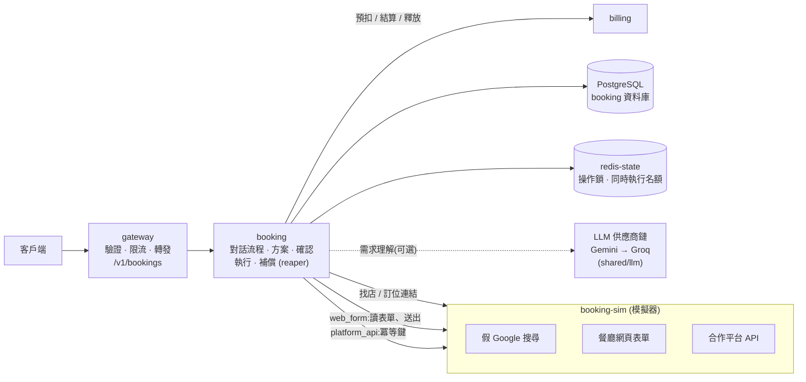
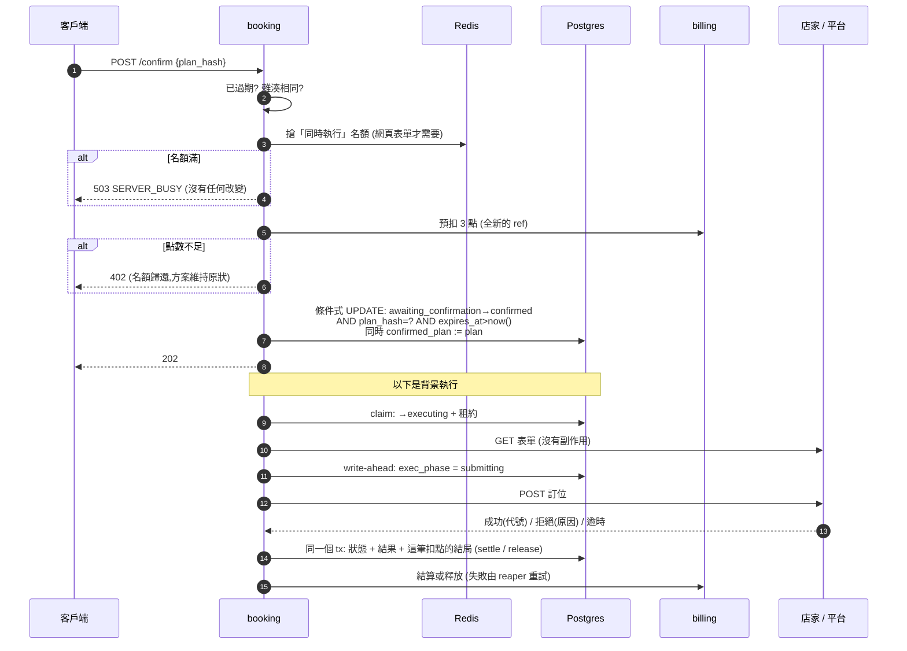

# 訂位代辦(AI 代辦)設計決策

> 範圍:後端題「AI 代辦」,以「幫我訂餐廳」為例。這是系統設計題(Chat APP)的**擴充**:新增兩個服務 `booking`(訂位服務)與 `booking-sim`(模擬器),沿用既有的 gateway、billing、PostgreSQL、Redis。
> 本文說明假設、取捨、刻意沒做的事,以及**實際驗證過什麼、沒驗證什麼**。API 見 [`../api/BOOKING-API.md`](../api/BOOKING-API.md)。

## 目錄
1. [需求與我的解讀](#1-需求與我的解讀)
2. [架構](#2-架構)
3. [假設](#3-假設)
4. [關鍵取捨](#4-關鍵取捨)
5. [可靠性:出事時系統怎麼表現](#5-可靠性出事時系統怎麼表現)
6. [刻意沒做的事](#6-刻意沒做的事)
7. [驗證:做了什麼、沒做什麼](#7-驗證做了什麼沒做什麼)
8. [技術選擇](#8-技術選擇)

---

## 1. 需求與我的解讀

作業要的最小流程:**一句話 → 方案 → 使用者確認 → 送出訂位 → 查結果**,加上點數明細。你另外提出五點與一個營運想法,我的對應如下:

| 需求 | 怎麼做 |
|---|---|
| 1. 判斷是不是訂位需求 | `POST /bookings/detect`:**純規則、免費、毫秒完成**。一般聊天不會多花一次模型呼叫或點數。取向是寧可漏判也不要誤判 |
| 2. 找店給使用者選;有指定店就搜尋有沒有訂位連結 | 未指名 → 依地區 / 料理找店,**只列出搜尋得到訂位連結的店**。指名 → 搜尋該店的訂位連結:找到就用(多家分店請使用者選);找得到店但**沒有連結**則明說無法代訂、附電話、並列同區可線上訂位的替代店家 |
| 3. 缺資料就問(有的要 email、有的要電話) | **缺什麼由店家的表單決定**:執行前先讀一次表單 / 平台能力,必填欄位 − 使用者已給的 = 要問的。實測:櫻花亭只問姓名 + 電話;檜木割烹多問 email;夜行居酒屋多一個「座位偏好」下拉選單 |
| 4. 使用者確認資訊正確才開始 | 方案有**雜湊值**;`confirm` 必須帶上使用者看到的那份的雜湊。確認什麼就只送出什麼(見 4.2) |
| 5. 隨時離開再回來 | 所有狀態(條件、待回答的問題、方案、進度、對話)都在 PostgreSQL,記憶體裡沒有必要的狀態。任何一台 instance 都能接手;`GET /bookings?status=active` 找回進行中的需求 |
| 初期用模擬器讓 AI 操作;同時最多 3 人,太多回應繁忙 | `booking-sim` 模擬 Google 搜尋、餐廳網頁表單、合作訂位平台。操作網頁的訂位**同時最多 3 筆**(Redis 租約,跨 replica 生效),第 4 筆確認時回 `503 SERVER_BUSY` + `Retry-After`,**什麼都沒改變、沒扣點**。細節見 4.1 |
| 未來很多人用再串接平台 API | 訂位管道是介面(`BookingChannel`)。**平台 API 管道已經實作**(對接模擬器上作業題描述的那種 API),餐廳的管道從 `web_form` 換成 `platform_api` 就不必動其他部分 |

作業規則的對應:

| 規則 | 做法 |
|---|---|
| 使用者確認了什麼方案,就只能送出那個方案 | 見 4.2 |
| 方案有確認期限,過期就不能再確認 | `expires_at`(預設 10 分鐘)。**判斷用資料庫時間**,寫在確認的條件式 UPDATE 裡:就算背景任務還沒掃到,也不可能確認過期的方案 |
| 每次使用 AI 都消耗點數;使用者與客服都能查明細 | 每輪 AI 理解 1 點、訂位成功 3 點;明細在既有的 `GET /points/ledger` 與後台,`ref_type` 區分 `booking_turn` / `booking`,`meta.booking_id` 可對回需求。後台的使用者詳情頁也列出訂位紀錄 |

## 2. 架構



**職責切分**(這是整個設計最重要的一條線):

| 元件 | 決定什麼 | 不決定什麼 |
|---|---|---|
| NLU(規則或 LLM) | 把使用者的話變成**條件**(日期、時間、人數、地區…) | 接下來問什麼、能不能出方案、送出什麼 |
| 對話流程(`dialog.ts`) | 依條件與**店家實際的表單**,決定下一步:選店 / 補資料 / 選時段 / 出方案 | 理解語言 |
| 方案 + 確認 | 凍結使用者確認的內容 | |
| 通道(`channels/`) | 把凍結的方案**機械式**對應到表單欄位 / API 欄位 | 任何「決定」 |

LLM 只能影響「這一輪抓到哪些欄位」。它寫錯、亂說,最壞只是少抓到一個欄位;**不可能跳過檢查、改變方案、影響送出的內容**。模型輸出一律當不可信資料:格式、範圍、日期是否已過期都重新檢查,不合格的欄位直接丟掉;整個 LLM 呼叫失敗或輸出不合法,就退回規則解析。

### 流程:從確認到結果



## 3. 假設

需求沒寫清楚的地方,我的判斷與依據:

| 項目 | 假設 | 依據 / 何時改變 |
|---|---|---|
| 「AI 理解」要多準 | 作業說不在評分範圍,所以用「規則解析 + 可選的 LLM」。**真正的防線是確認步驟**:解析錯了,使用者會在方案上看到(含星期幾)並在確認前修改 | 作業原文。若要提高準確度,加強 NLU 即可,不影響其他部分 |
| 哪些動作算「使用 AI」要扣點 | 每次**經過 AI 理解**的使用者訊息扣 1 點(建立、`messages`);按鈕 / 表單(`slots`)不經 AI,不扣;訂位本身成功才扣 3 點 | 「每次使用 AI 都消耗點數」。按鈕不是 AI,扣它沒有道理。規則解析退回時仍扣:使用者要的是這個「代辦服務的一輪」,而不是特定的技術 |
| 失敗要不要扣點 | **失敗一律不扣**(AI 理解出錯、店家客滿、結果不明) | 與既有的聊天一致(失敗的回覆不扣點)。使用者沒得到東西就不收錢 |
| 結果不明要不要扣 | 不扣 | 無法證明服務已完成。代價:若實際上訂成了,我們沒收到 3 點。這個金額很小,而收一個「可能沒訂成」的費用的客訴成本更高 |
| 台灣時區、一週從週一開始 | 固定 UTC+8(台灣沒有日光節約時間)。「這週五」= 今天起(含今天)最近的週五;「下週五」= 下一個週一~週日那一週的週五 | 習慣用法。方案會顯示 `2026-11-13(週五)`,讓使用者確認 |
| 沒說上午下午 | 1~10 點視為下午(7 點 = 19:00) | 訂餐廳的情境 |
| 聯絡資料 | 只存在這筆需求裡,**不跨需求預填**;使用者刪帳號時隨需求一併刪除(`user.deleted` 事件) | 電話 / email 是個資,先不做保留。預填是好功能,但要先決定保留期限與使用者同意 |
| 方案期限 | 10 分鐘;草稿 24 小時沒動就作廢 | 餐廳位子會變動,方案不能放太久。可用 `PLAN_TTL_SEC` / `DRAFT_TTL_SEC` 調整 |
| 一人同時進行中的草稿 | 最多 5 筆 | 防濫用 |
| 點數價格 | 理解 1、訂位 3(`COST_TURN` / `COST_BOOK`) | 沒有成本資料,隨意定的。訂位比較貴因為它代表「事情辦成了」 |
| 模擬器代表什麼 | 它**不是**真實平台,只用來驗證流程與異常。所有「Google」「餐廳網站」「訂位平台」的行為都是我寫的 | 作業說沒有測試環境,請自行模擬 |

## 4. 關鍵取捨

### 4.1 「用模擬器讓 AI 去操作」+「最多 3 人,太多就繁忙」

你問「或是你有更好的做法」。我保留了你的設計(上限 3、超過回繁忙),但做了三個修正:

**(a) 上限只管「操作網頁」的那一段,不是整個服務。** 找店、問店家表單是唯讀的一次 GET,很輕,不受限;真正佔資源又會對外產生副作用的是「送出表單」,只限制它。未來 `platform_api` 管道是 API 呼叫,`limited = false`,不受這個上限(它有自己的限流需要另外處理)。

**(b) 繁忙發生在「確認」那一刻,而且不改變任何狀態。** 搶不到名額 → `503`,方案保持 `awaiting_confirmation`,沒預扣點數。使用者稍後重試即可。名額用 Redis 租約(sorted set,分數是到期時間),跨 replica 共用;程序當機後租約自己到期,名額會自動歸還。實測:4 人同時確認 → 3 人受理、1 人繁忙;其餘完成後,被擋下的人重試成功。

**(c) 我沒有讓 LLM 去「操作」網頁,而是用程式把確認過的方案對應到表單欄位。** 這是最大的偏離,理由:

- 「確認什麼就只能送出什麼」是硬規則。讓模型決定「填什麼」,就等於讓它有機會送出和使用者確認的不一樣的內容。把方案機械式對應到欄位,送出的內容就可以**被證明**等於確認的內容(測試直接比對對方收到的資料)。
- 程式化的操作可重現、可測試、不花點數以外的錢,而且在沒有 API key 的環境一樣能跑完整個流程。
- 代價:一般網頁通道只能處理**有 `<form>` 的靜態頁面**(用 Bun 內建的 `HTMLRewriter` 解析)。真實訂位改為獨立 `browser-agent`(Python + browser-use + Docker Chromium),目前**只支援已授權的享樂地圖(JoyMap)測試店家**。**分工**:LLM 只在店家頁選人數、日期、時段(點擊);訂位頁的姓名、稱謂、email、手機、用餐目的、備註、同意條款由程式工具 `fill_contact_form` 填寫並回讀比對;最終「確認訂位」只能經由 `submit_reservation`,按下前再比對一次頁面上的日期 / 時間 / 人數與所有欄位,LLM 自己點送出類按鈕會被擋下。理由:實測 LLM 會按 Escape 關掉對話框、用過期的元素索引點錯元素,這些都會讓「送出的內容」偏離「確認的內容」。程式記錄是否按過送出(先記錄再點擊),從沒按過就確定店家沒收到,可以安全地自動重跑一次或回報失敗。稱謂(先生/小姐)與用餐目的以 `extraFields` 向使用者詢問,不替使用者猜。先前嘗試的 Google Reserve(送出被 Google 反濫用拒絕,`finalizebooking` 回空結果)與 inline 已停止。
- 什麼時候會改變決定:如果要處理版面各異的真實網站、而且接受 LLM 可能出錯,可以讓 LLM 做「找出哪個欄位對應方案的哪個值」,但**值必須仍然來自方案**,並對模型的輸出做嚴格驗證。

**放棄的做法:排隊。** 超過 3 人就排隊等候,體驗比「繁忙」好。沒做是因為:排隊要處理「排隊中方案過期」「使用者離開了還要不要做」「隊伍多長要拒絕」,而你的目標是初期驗證需求、人數很少。回應繁忙更簡單、行為更可預期。改變決定的條件:繁忙回應被使用者頻繁遇到。

### 4.2 確認什麼就只能送出什麼

三道防線,任何一道失效其他仍然成立:

1. **雜湊比對**:`confirm` 必須帶上使用者看到的方案的雜湊(`plan_hash`),與伺服器目前的方案不同 → `409 PLAN_CHANGED` 並附上最新方案。這擋住「使用者在手機看到方案 A,同時另一支裝置把它改成 B,然後在手機按確認」。實測:改成 8 點後用舊雜湊確認被擋下,且對方沒收到任何東西。
2. **條件式 UPDATE**:`WHERE status='awaiting_confirmation' AND plan_hash=$ AND expires_at > now()`,同時把方案複製進 `confirmed_plan`。檢查與狀態改變是一個原子操作,不存在「檢查過了但提交時過期」。
3. **資料庫 trigger**:`confirmed_plan` 一旦有值就不可修改(`RAISE EXCEPTION`)。實測:直接對資料庫 UPDATE 會被拒絕。送出時只讀這一欄,**連送到哪個網址 / 平台**也包含在方案裡(`plan.target`),執行時不會重新搜尋或重新決定。

另外:在對話框打「確認」**不會**送出。LLM 可能把任何一句話理解成同意,送出一筆有真實後果的訂位不能靠語言理解。

### 4.3 點數:預扣 → 結算 / 釋放,結局和結果同一個 transaction

沿用聊天的模型(不用分散式交易),差別是這裡有兩種扣點(理解、訂位)與非同步的結果。每次扣點在 `charges` 表有一列:

```
holding → held ──(與訂位結果同一個 DB tx)──▶ settle_pending ──▶ settled
                                           └▶ release_pending ──▶ released
```

「該扣還是該退」和「訂位成功還是失敗」**在同一個 transaction 裡決定**,所以不會出現「訂位成功但沒扣」或「失敗卻扣了」。通知 billing 失敗沒關係(已決定,reaper 每 5 秒重送,billing 的 settle / release 都是冪等的)。

**逾時 ≠ 失敗**(聊天踩過的坑):預扣呼叫逾時時,billing 可能已經預扣了。只有明確收到 4xx 才能確定沒預扣;其他一律當作可能有,標成 `release_pending` 交給 reaper 釋放。

**驗證時抓到的真 bug**(見 AI-LOG):扣點的 `ref` 原本是固定的 `bk:{id}:book`。第一次確認因點數不足被拒、補點後再確認時,billing 預扣成功,但我這邊那筆紀錄已被標成 `released`,之後的結算更新不到任何列 → **訂位成功、沒收到錢、預扣卡住**。修正:每次嘗試都用全新的 ref,並把目前有效的 ref 存在 `bookings.charge_ref`。

### 4.4 結果不明:逾時不等於失敗,也不能亂重試

送出訂位後逾時,有三種可能:店家沒收到、收到了訂成了、收到了但回應丟了。**網頁表單沒有冪等機制**,重送 = 可能重複訂位。所以:

| 管道 | 結果不明時 | 原因 |
|---|---|---|
| `web_form` | 標記 `unknown`,**絕不自動重送**,不扣點,告訴使用者請向店家確認 | 重送可能重複訂位,這比沒訂成更糟 |
| `platform_api` | 用**同一個冪等鍵**(訂位 id)重送最多 3 次;平台保證不會重複 | 這是標準做法。實測:平台第一次收單但回 503,重送後拿回同一個訂位編號,平台只有 1 筆 |

**write-ahead 記號**讓「當機後怎麼辦」有答案:送出請求之前,先把 `exec_phase` 寫成 `submitting`。接手的 instance 看到:

- `pre_submit` → 什麼都還沒送出,直接重做;
- `submitting` + 有冪等鍵 → 同一個鍵重送;
- `submitting` + 沒有冪等鍵 → 標記 `unknown`,不重送。

實測:送出途中 `SIGKILL` booking 容器 → 重啟後租約到期(30 秒)→ 標記 `unknown`、釋放預扣,模擬器只有 1 筆。

### 4.5 需求理解:規則 + 可選的 LLM

| 選項 | 取捨 |
|---|---|
| **規則(預設可用)** | 免費、快、可重現,沒有 API key 也能跑。對慣用說法(「這週五晚上 7 點,4 個人,信義區的日式料理」)夠用;對複雜說法會漏抓 |
| **LLM(設了金鑰才用)** | 語言涵蓋廣。但會錯、會慢、要錢。輸出經嚴格驗證,失敗退回規則 |

用 `LLM_PROVIDERS`(沿用聊天的供應商工廠與備援,已搬到 `shared/llm`)決定。沒設或是 `mock` → 規則。LLM 全部不可用 → 退回規則(實測:兩家都連不上,仍然正常建立需求,有日誌與指標)。

**沒有把 LLM 和規則的結果合併**。合併要處理衝突規則,而確認步驟已經是防線,簡單比聰明好。

### 4.6 「搜尋 Google」

目前搜尋是模擬器。要接真的:找店可用 Google Places API (New) 的 Text Search;找訂位連結需要一般網頁搜尋。**不能用 Google Custom Search JSON API**:我查到它已不接受新客戶,且 2027/1/1 停用([來源](https://developers.google.com/custom-search/v1/overview)),需另選網頁搜尋服務,再用網域(inline.app、EZTABLE 等)分類訂位平台。這些我**沒有串接、也沒驗證**,只留了 `SearchProvider` 介面。

## 5. 可靠性:出事時系統怎麼表現

| 狀況 | 表現 | 驗證 |
|---|---|---|
| 同一則訊息重送(網路重試) | 只處理一次、只扣一次(`client_msg_id`) | ✅ |
| 同一個建立請求重送 | 回傳同一筆(`client_request_id`) | ✅ |
| 同一筆需求並發 5 個操作 | 1 個處理,其餘 `409 TURN_IN_PROGRESS`,只扣 1 次 | ✅ |
| 確認後重送確認 | 冪等,不重複執行 | ✅ |
| 方案過期後確認 | `409 PLAN_EXPIRED`,不扣點。背景任務也會把狀態落地 | ✅ |
| 方案被改後用舊雜湊確認 | `409 PLAN_CHANGED`,附最新方案,對方沒收到東西 | ✅ |
| 同時確認的人超過 3 | 多出來的 `503 SERVER_BUSY`,無任何改變 | ✅(含 2 個 replica) |
| 點數不足 | `402`,方案維持原狀;補點後直接再確認並正確結算 | ✅ |
| 店家客滿 | `failed`(附原因),預扣退還 | ✅ |
| 店家公休 / 指定時段沒位子 | 不出方案,請使用者改日期 / 選時段 | ✅ |
| 找得到店但沒有訂位連結 | 明說無法代訂、附電話、列替代店家 | ✅ |
| 店家表單要的資料各異 | 逐家詢問(電話 / email / 下拉選單) | ✅ |
| 送出後店家不回應 | `unknown`,不重送,不扣點 | ✅ |
| 平台第一次回 503 但已收單 | 同一冪等鍵重送,拿回原結果,平台 1 筆 | ✅ |
| 送出前就連不上店家 | `failed`(確定沒送出),不扣點 | ✅ |
| 修改條件時店家頁面 / 搜尋壞了 | `503`,狀態不變,不扣點 | ✅ |
| LLM 全部不可用 | 退回規則解析 | ✅ |
| booking 程序在送出途中被殺 | 租約到期後依 write-ahead 記號接手(見 4.4) | ✅(web_form 實測 SIGKILL;platform_api 以改資料庫狀態模擬接手點) |
| billing 暫時不可用 | 預扣失敗 → 503,狀態不變、名額歸還;預扣「結果不明」的嘗試由 reaper 釋放。訂位完成時結算失敗 → 扣點停在 `settle_pending`(與訂位結果同一個 tx 已決定),billing 恢復後約 20 秒內自動結算 | ✅ 實際 `docker compose stop billing` 演練兩種情境 |
| 多個 booking replica | 鎖、名額、接手都不依賴單一程序 | ✅ 68 項在 2 個 replica 上全過 |
| 使用者刪帳號 | 需求、對話、扣點紀錄一併刪除 | ✅ 實測:刪除後該使用者的需求 / 事件 / 扣點皆為 0 筆 |

## 6. 刻意沒做的事

| 項目 | 原因 | 何時做 |
|---|---|---|
| 客戶端畫面(Flutter) | 作業說前端不在評分範圍;API 已經包含畫面需要的一切(`pending` 告訴客戶端該顯示什麼) | 要給使用者用時 |
| 聊天自動轉成訂位 | 現在是客戶端先呼叫 `detect`。改成伺服器端要動聊天的熱路徑(已有 36 項測試保護的流程),風險大於效益 | 客戶端整合時評估 |
| 串流 / 推播通知進度 | 用輪詢(`GET`)夠用:訂位通常幾秒內完成。結果不明或失敗時使用者回來才看到 | 使用者抱怨「不知道辦好了沒」時,可複用事件通道 |
| 確認後取消 | 請求可能已離開系統,取消只會造成「以為取消了其實訂了」 | 平台提供取消 API 時 |
| 結果不明時自動查詢 | 網頁表單常有「查詢我的訂位」頁;查到就能從 `unknown` 變成 `succeeded`。要為每種網站寫查詢邏輯 | 結果不明的比例高到值得做時 |
| `unknown` 之後晚到的成功 | 若店家的回應事後才到,現在不會升級狀態 | 同上 |
| 排隊 | 見 4.1 | 繁忙回應太常出現時 |
| 聯絡資料跨需求預填 | 個資保留期限與同意要先決定 | 產品決定後 |
| 真實網站瀏覽器自動化 | 已取得授權;目前僅享樂地圖測試店家 jump888。最終「確認訂位」預設關閉,需設 `BROWSER_AGENT_SUBMIT_ENABLED=true` | ✅ dry run 實測:選人數 / 日期 / 時段、程式填表並驗證通過;尚未以 agent 建立真實訂位 |
| 每日 AI 花費上限、對 LLM 的限流 | 目前靠每人 30 次/分鐘的寫入限流與點數間接約束 | 開放真實使用者前 |
| 後台的人工處理(把 `unknown` 標成成功 / 失敗、手動補償) | 客服現在只能查看 | 出現第一個 `unknown` 客訴時 |
| 對 `booking-sim` 之外的餐廳資料做快取 | 搜尋是唯讀且很快;沒有流量資料證明需要 | 有真實搜尋的延遲與費用後 |

## 7. 驗證:做了什麼、沒做什麼

**做了**

- `backend/booking/scripts/booking-smoke.ts`:**68 項**端到端檢查,從 gateway 的對外 API 走完整流程,並用模擬器的 `/__debug/reservations` 確認「對方實際收到什麼」,用資料庫確認扣點沒有殘留。執行方式:
  ```bash
  docker compose --profile tools run --rm --no-deps tools bun booking/scripts/booking-smoke.ts
  ```
  在三種設定下都是 68/68:(a) 沒有任何金鑰(規則解析);(b) 設了 Gemini 金鑰(LLM 解析);(c) 2 個 booking replica。
- 既有的聊天冒煙測試(`scripts/smoke.ts`)在 mock 模型下 37/37,確認搬動 `llm` 模組與修改 billing 沒有造成退步。
- 手動演練(不適合自動化的):SIGKILL 當機、停掉模擬器、停掉 billing(預扣失敗與結算失敗兩種)、LLM 全部連不上、刪除帳號、直接對資料庫改 `confirmed_plan`。這些**沒有**寫進自動測試,要重現得照做一次。

**沒做 / 未驗證**

- **享樂地圖的成功畫面未驗證。** 程式判斷成功的字樣(「訂位成功」「訂位編號」等)是推測的;沒讀到就回報「結果不明」、不會重送。第一筆真實訂位後要依實際畫面校正。公休日與已滿時段沒有事先查詢,由 agent 在頁面上發現後回報 `SLOT_UNAVAILABLE`(不會送出)。
- **沒有實際建立真實訂位。** `BROWSER_AGENT_SUBMIT_ENABLED` 預設 false,只有明確開啟後才會按下「確認訂位」。
- **LLM 解析只驗證了「能跑通且結果通過驗證」**:用你 `.env` 的 Gemini 金鑰跑過冒煙測試的句子,但**沒有量過準確度**。對複雜或含糊的說法表現未知。
- **沒有壓力測試。** 「同時 3 筆」的行為驗證了,但沒有量過 booking 在高併發下的容量。
- **沒有跑過客戶端**,後台的訂位表只驗證了資料 API 與頁面 JavaScript 語法,沒有在瀏覽器裡看過畫面。
- 擴成多個 replica 後,我看到 gateway 沒有立刻把流量分給新的 replica,重啟 gateway 後才平均分配。這段程式碼是聊天原本就有的,我沒有查出原因,所以**不宣稱 gateway 會自動發現新 replica**。

## 8. 技術選擇

TypeScript(Bun)。作業建議 TypeScript/Node.js 或 Go;這裡沿用既有服務的技術棧(你在系統設計題指定了 Bun),新服務可以直接重用 gateway、billing、LLM 供應商工廠與共用函式庫,不必另寫一套。

這個情境用到的特性:
- **單執行緒事件迴圈 + 非同步 I/O**:服務大部分時間在等外部(模型、店家網頁、billing),不是在算東西。幾十個同時進行的「等待」很便宜;
- **內建 `HTMLRewriter`**:不需要額外套件就能解析表單;
- **`zod` + TypeScript 型別**:狀態、方案、通道介面都有型別,模型的輸出用 `zod` 驗證;
- **代價**:單執行緒不適合 CPU 密集(這裡沒有);之後換成瀏覽器自動化時,瀏覽器是獨立行程,不受影響。
