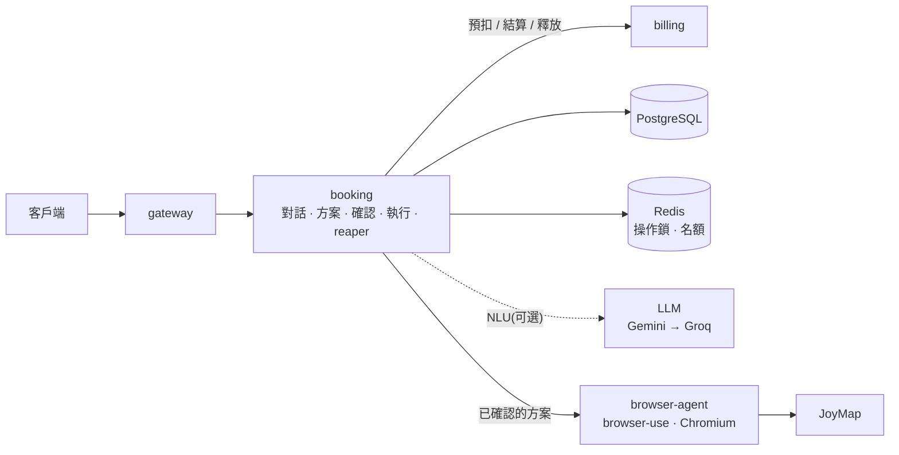
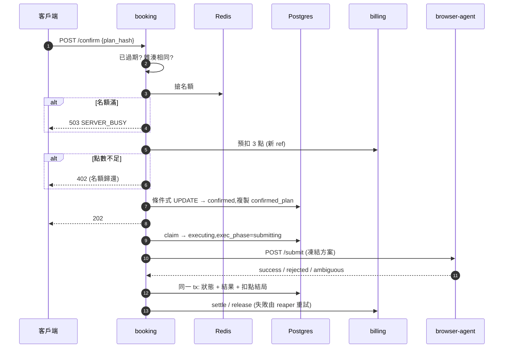

# 訂位代辦(AI 代辦)設計決策

> 「幫我訂餐廳」是 Chat APP 的擴充:新增 `booking`(訂位服務)與 `browser-agent`(Python,操作瀏覽器),沿用 gateway、billing、PostgreSQL、Redis。API 見 [`../api/BOOKING-API.md`](../api/BOOKING-API.md)。

## 1. 需求對應

流程:**一句話 → 方案 → 使用者確認 → 送出 → 查結果**。

| 需求 | 做法 |
|---|---|
| 判斷是否訂位需求 | `POST /bookings/detect`:純規則、免費。寧可漏判不誤判 |
| 找店 / 找訂位連結 | `SearchProvider` 介面。目前只有享樂地圖(JoyMap)測試店家「TEST01:Jump!Jump!」,提到「Jump」或「TEST01」才找得到;其他回「找不到」。多家候選、無訂位連結的路徑已支援但目前不會觸發 |
| 缺資料就問 | 管道的 `inspect` 回報必填欄位,必填 − 已給 = 要問的。JoyMap 要姓名、手機、email、稱謂、用餐目的 |
| 確認才開始 | 方案有雜湊,`confirm` 須帶雜湊(見 3.1) |
| 隨時離開再回來 | 狀態全在 PostgreSQL,任一 instance 可接手;`GET /bookings?status=active` 找回進行中需求 |
| 最多 3 人同時操作網頁 | Redis 租約(跨 replica),第 4 筆回 `503 SERVER_BUSY` + `Retry-After`,無任何改變、不扣點 |
| 未來串平台 API | `BookingChannel` 介面,新增管道不動對話、方案、點數。目前只有 browser-agent |
| 方案期限 | `expires_at`(預設 10 分鐘),用資料庫時間寫在確認的條件式 UPDATE 裡 |
| 點數 | 每輪 AI 理解 1 點、訂位成功 3 點;明細在 `GET /points/ledger` 與後台(`ref_type` = `booking_turn` / `booking`,`meta.booking_id`) |

## 2. 架構



**職責切分**:

| 元件 | 決定 | 不決定 |
|---|---|---|
| NLU(規則或 LLM) | 把話變成條件(日期、時間、人數…) | 問什麼、能否出方案、送出什麼 |
| 對話流程(`dialog.ts`) | 依條件與管道規則決定下一步 | 理解語言 |
| 方案 + 確認 | 凍結使用者確認的內容 | |
| 管道與 browser-agent | 把凍結方案對應到網頁操作 | 任何「決定」 |

LLM 最壞只是少抓一個欄位,不可能改變方案或送出內容。模型輸出視為不可信:重新檢查格式、範圍、日期,不合格就丟;呼叫失敗則退回規則解析。



## 3. 關鍵取捨

### 3.1 確認什麼就只送出什麼

三道防線,任一失效其他仍成立:

1. **雜湊比對**:`plan_hash` 與伺服器目前方案不同 → `409 PLAN_CHANGED` 並附最新方案。
2. **條件式 UPDATE**:`WHERE status='awaiting_confirmation' AND plan_hash=$ AND expires_at > now()`,同時寫入 `confirmed_plan`。檢查與狀態改變是原子操作。
3. **DB trigger**:`confirmed_plan` 有值後不可修改。送出只讀這一欄,連目標網址(`plan.target`)都在方案裡。

在對話框打「確認」**不會**送出,有真實後果的動作不能靠語言理解。

### 3.2 AI 操作網頁與 3 人上限

- **上限只管操作網頁那段**:找店與 `inspect` 不開瀏覽器。API 型管道可設 `limited = false`。
- **繁忙發生在確認時且不改狀態**:搶不到名額 → 503,方案維持 `awaiting_confirmation`。租約在程序當機後自動到期。
- **LLM 只點選,不決定填什麼、不按最終送出**(最大的偏離,因為「確認什麼送出什麼」是硬規則):
  - LLM(browser-use)只選人數、日期、時段;只開放 `navigate / click / scroll / wait / select_dropdown / dropdown_options / done`,無文字輸入。
  - 程式用 `fill_contact_form` 填姓名、稱謂、email、手機、用餐目的、備註、同意條款,並**回讀與方案逐項比對**(含日期、時間、人數)。
  - 最終送出只能經 `submit_reservation`,按下前再核對;LLM 點到送出類按鈕會被擋。**先記錄再點擊**(`maybe_submitted`):沒記錄過 → 店家一定沒收到,可安全重跑(最多兩次);記錄過 → 只能成功或不明,絕不重跑。
  - 成功必須由程式讀到:JoyMap 訂位 API `code == 1` 且有 `order_no`,或結果頁 `/reservation-success` 出現成功字樣。LLM 自稱成功不採信。
  - `BROWSER_AGENT_SUBMIT_ENABLED` 預設 `false`:跑到按鈕前回報 `DRY_RUN_READY`,視為失敗、不扣點。
  - agent 只接受與 `BROWSER_BOOKING_URL` 相同的網址(預設 `https://www.joymap.tw/store/jump888`),新網站要寫新邏輯(目前只有 `joymap.py`)。
- 代價:每個網站都要各自寫邏輯。
- **不做排隊**:要處理排隊中方案過期、使用者離開、隊伍上限,而目前人數少。繁忙回應較簡單可預期。繁忙被頻繁遇到時再議。

### 3.3 點數:預扣 → 結算 / 釋放

每次扣點在 `charges` 表一列:

```
holding → held ──(與訂位結果同一個 tx)──▶ settle_pending → settled
                                       └▶ release_pending → released
```

- 扣或退與訂位成敗**同一個 tx 決定**,不會「成功沒扣」或「失敗卻扣」。通知 billing 失敗由 reaper 每 5 秒重送(settle / release 冪等)。
- **逾時 ≠ 失敗**:預扣逾時時 billing 可能已預扣。只有明確 4xx 才確定沒預扣,其餘標 `release_pending` 交 reaper 釋放。
- **每次嘗試用全新 `ref`**,存在 `bookings.charge_ref`。否則第一次因點數不足被拒、補點後再確認時,本地紀錄已是 `released`,結算更新不到列,變成訂位成功卻沒收到錢、預扣卡住。

### 3.4 結果不明:不重送

browser-agent 沒有冪等保證(`idempotent = false`),重送可能重複訂位。以下情況標 `unknown`,不重送、不扣點,請使用者向店家確認:

- agent 回報 `ambiguous`(按過送出但沒讀到成功);
- booking 呼叫 agent 逾時或連不上。

**write-ahead**:送出前先寫 `exec_phase = submitting`。當機後接手的 instance:

- `pre_submit` → 直接重做;
- `submitting` + 無冪等鍵(現況)→ `unknown`;
- `submitting` + 有冪等鍵(介面支援,目前無此管道)→ 同一個鍵重送。

逾時設定:booking → agent HTTP 600 秒;agent 單次最多 270 秒、總預算 560 秒。

### 3.5 需求理解:規則 + 可選 LLM

- **規則**(預設):免費、快、可重現,慣用說法夠用,複雜說法會漏抓。
- **LLM**(`LLM_PROVIDERS` 有設才用,沿用 `shared/llm`):涵蓋廣但會錯、慢、花錢。輸出嚴格驗證,失敗退回規則,有指標 `booking_nlu_total{source}`。
- 不合併兩者結果:確認步驟已是防線,簡單優先。

### 3.6 找店

`BookingSearch` 只認享樂地圖測試店家(店名含「Jump」或「TEST01」,全形也算),避免泛查詢被錯導,其餘回空。

接真實搜尋的方向:找店用 Google Places API (New) Text Search;找訂位連結需另選網頁搜尋服務,因為 [Google Custom Search JSON API 不收新客戶且 2027/1/1 停用](https://developers.google.com/custom-search/v1/overview)。以上**沒串接也沒驗證**,只留 `SearchProvider` 介面。

## 4. 假設

| 項目 | 假設 |
|---|---|
| AI 理解準確度 | 作業不評分,用規則 + 可選 LLM。防線是確認步驟:解析錯會在方案上(含星期幾)被看到 |
| 哪些算 AI 要扣點 | 經 AI 理解的訊息(建立、`messages`)扣 1 點,規則退回時仍扣;按鈕 / 表單(`slots`)不扣;訂位成功扣 3 點 |
| 失敗與結果不明 | 一律不扣。結果不明時若實際訂成了就少收 3 點,金額小於客訴成本 |
| 時區與週 | 固定 UTC+8、週一起算。「這週五」= 含今天最近的週五;「下週五」= 下一週的週五 |
| 沒說上午下午 | 1~10 點視為下午 |
| JoyMap 規則 | 10:00–22:00 每 30 分鐘、單筆最多 8 位、需姓名 + 手機 + email。固定寫在管道裡,建立方案時不開瀏覽器。公休 / 已滿到確認後才知道,回報 `SLOT_UNAVAILABLE`(不送出、不扣點)。規則改變要改 `channels/browser-agent.ts` |
| 聯絡資料 | 只存在該筆需求,不跨需求預填;刪帳號時隨需求刪除(`user.deleted`)。預填需先決定保留期限與同意 |
| 期限 | 方案 10 分鐘(`PLAN_TTL_SEC`);草稿 24 小時作廢(`DRAFT_TTL_SEC`) |
| 草稿上限 | 每人 5 筆(`collecting` + `awaiting_confirmation`) |
| 價格 | 理解 1、訂位 3(`COST_TURN` / `COST_BOOK`),無成本依據 |

## 5. 可靠性

「曾實測」= 移除模擬器前由 68 項端到端測試或手動演練驗證;該測試已不存在,**目前無自動測試保護**。

| 狀況 | 表現 | 驗證 |
|---|---|---|
| 訊息重送 | 只處理、只扣一次(`client_msg_id`) | 曾實測 |
| 建立請求重送 | 回同一筆(`client_request_id`) | 曾實測 |
| 同需求並發操作 | 1 個處理,其餘 `409 TURN_IN_PROGRESS` | 曾實測 |
| 確認後重送確認 | 冪等 | 曾實測 |
| 方案過期後確認 | `409 PLAN_EXPIRED`,不扣點 | 曾實測 |
| 舊雜湊確認 | `409 PLAN_CHANGED`,不送出 | 曾實測 |
| 同時確認超過 3 | 多的 `503 SERVER_BUSY`,無改變 | 曾實測(含 2 replica) |
| 點數不足 | `402`,方案不變;補點後可再確認並正確結算 | 曾實測 |
| 刪帳號 | 需求、對話、扣點紀錄一併刪除 | 曾實測 |
| LLM 全部不可用 | 退回規則 | 曾實測 |
| billing 不可用 | 預扣失敗 → 503、名額歸還;結算失敗 → 停在 `settle_pending`,恢復後 reaper 結算 | 曾實測 |
| booking 送出途中被殺 | 租約到期後依 write-ahead 接手;無冪等鍵 → `unknown` | 曾實測,但用已移除的模擬器,**未用 browser-agent 重測** |
| 公休 / 時段已滿 | `SLOT_UNAVAILABLE`,不送出、不扣點 | 未驗證 |
| agent 填表失敗、從沒按送出 | `failed`(`NOT_SUBMITTED`),不扣點 | 未驗證 |
| 最終送出關閉(預設) | `DRY_RUN_READY`,視為失敗、不扣點 | dry run 曾實測 |
| 按過送出但沒讀到成功 | `unknown`,不重送、不扣點 | 未驗證 |
| 呼叫 agent 逾時 / 連不上 | `unknown`,不重送、不扣點 | 未驗證 |

## 6. 刻意沒做

| 項目 | 原因 / 何時做 |
|---|---|
| 其他訂位網站 | 只有已授權的 JoyMap 測試店家;有其他授權網站時再做 |
| 平台 API 管道 | 介面已預留,無可串平台;有合作平台時做 |
| 聊天自動轉訂位 | 要動聊天熱路徑,風險大於效益;現在由客戶端先呼叫 `detect` |
| 串流 / 推播進度 | 執行中每 2 秒輪詢夠用 |
| 確認後取消 | 請求可能已送出,取消會造成誤解;有取消 API 時再做 |
| `unknown` 自動查詢 / 晚到成功升級 | 要為每個網站寫查詢邏輯;`unknown` 比例高時做 |
| 排隊 | 見 3.2 |
| 聯絡資料預填 | 需先決定保留期限與同意 |
| 每日 AI 花費上限、LLM 限流 | 目前靠每人 30 次/分鐘寫入限流與點數約束;開放真實使用者前補 |
| 後台人工處理 `unknown` | 客服目前只能查看;出現第一個客訴時做 |

## 7. 驗證

**現有**:`bun run typecheck`;`scripts/smoke.ts`(只涵蓋聊天);browser-agent dry run(選人數 / 日期 / 時段、填表並核對通過,不按最終送出)。

**訂位目前沒有自動化測試。** 先前的 68 項端到端測試隨模擬器移除。手動演練(SIGKILL、停 billing、LLM 全斷、刪帳號、直接改 `confirmed_plan`)也未寫成自動測試。

**未驗證**:

- JoyMap 成功判斷依觀察到的行為(API 回應格式、結果頁文字)撰寫,改版會失效,失效時回報 `unknown`,不會重送。最終送出預設關閉,尚無真實訂位紀錄,第一筆後需依實際畫面校正。
- 公休與已滿時段沒有事先查詢。
- LLM 解析準確度未量測。
- 無壓力測試,未量過高併發容量。
- 後台訂位表只驗證過資料 API 與 JS 語法,沒在瀏覽器看過。Flutter 訂位畫面已實作,本文未逐項驗證。

## 8. 技術選擇

沿用既有 TypeScript(Bun),可重用 gateway、billing、LLM 工廠與共用函式庫。事件迴圈適合 booking 大量等待外部服務的特性,狀態與方案用 `zod` + 型別約束。瀏覽器自動化生態在 Python,獨立成 browser-agent,Chromium 不影響 booking 事件迴圈。代價是多一個語言與一個 image 要維護。
