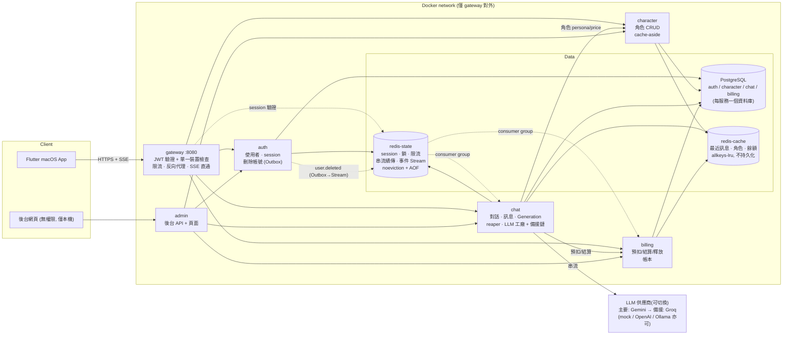
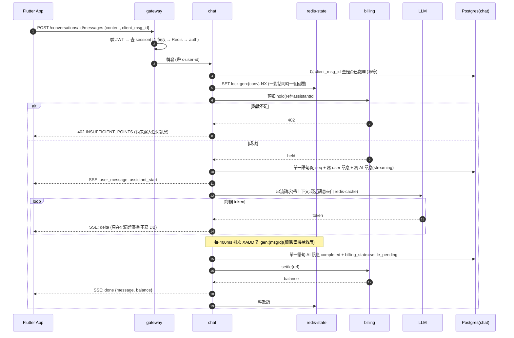
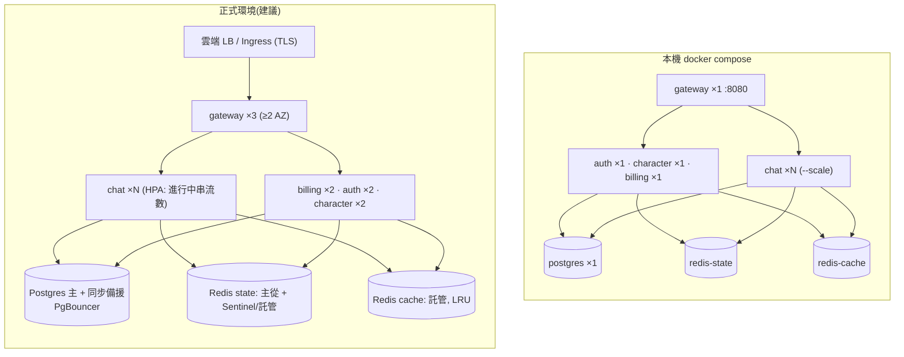

# Chat APP 後端系統設計

> 範圍:AI 陪伴 App 的「和 AI 角色聊天」。本文件說明假設、架構、最難的問題、演進與維運,
> 並附上實際跑出來的驗證數據(第 7 節)。所有數字都標明是**推估**還是**實測**。

## 目錄
1. [假設](#1-假設)
2. [架構](#2-架構)
3. [最難的三個問題](#3-最難的三個問題)
4. [Redis 快取設計](#4-redis-快取設計)
5. [演進:成長時先改哪裡](#5-演進成長時先改哪裡)
6. [維運](#6-維運)
7. [驗證:實測數據](#7-驗證實測數據)
8. [刻意沒做的事](#8-刻意沒做的事)

---

## 1. 假設

需求沒寫清楚的地方,我的判斷與依據:

| 項目 | 假設 | 依據 |
|---|---|---|
| **「使用者單一裝置」** | 同一時間每位使用者只有 **1 個有效登入**;新裝置登入會讓舊裝置立即登出。對話紀錄存在伺服器,所以換裝置登入後看到同一份。 | 題目同時要求「手機和平板看到同一份紀錄」與「單一裝置」。兩者不衝突的解讀是:*紀錄跨裝置共享,登入互斥*。若本意是「允許多裝置同時在線」,改動集中在 auth 的 `sessions` 主鍵(見第 5 節)。 |
| 對話模型 | 一位使用者與一個角色 **只有一條連續對話** | 陪伴型產品的核心是關係的延續,而不是一次性的聊天串。 |
| 目標使用者 | 台灣為主,繁體中文;首年 **MAU 50 萬、DAU 10 萬** | 對標中小型陪伴 App 的合理起點。 |
| 使用行為 | DAU 每人每天 **40 則**對話(= 40 次 AI 回覆) | 陪伴類 App 黏著度高;這是最敏感的參數,見下方推估。 |
| 尖峰 | 平均的 **5 倍**,集中在晚間 | 陪伴類使用高峰明顯。 |
| AI 回覆 | 平均 **150 字**、生成約 **8 秒** | 對話式回覆,非長文。 |
| 計價 | 每則成功回覆扣固定點數(依角色 2–3 點) | 簡單、可預期。失敗的回覆**不扣點**。 |
| 團隊 | **3–5 位後端工程師**,無專職 SRE | 決定了:選用成熟元件、少用自建基礎設施、運維手段要簡單。 |
| 刪除帳號 | 對話、點數明細**全部刪除**;若有法遵要求保留帳務,改為去識別化(第 8 節) | 題目明確要求。 |

### 規模推估(算式)

```
AI 回覆數/日     = DAU × 每人則數            = 100,000 × 40            = 4,000,000 則/日
平均速率         = 4,000,000 ÷ 86,400        ≈ 46 則/秒
尖峰速率         = 46 × 5                    ≈ 230 則/秒

同時進行中的串流 = 速率 × 單則生成時間(Little's Law)
                 = 230 × 8 秒                ≈ 1,840 條 同時串流(尖峰)

儲存(每則訊息 user + assistant 各一列,實測 ≈ 490 B/列,含 3 個索引)
  新增列數/日    = 4,000,000 × 2             = 8,000,000 列/日
  新增容量/日    = 8,000,000 × 490 B         ≈ 3.9 GB/日  ≈ 1.4 TB/年

Redis 快取(最近 40 則/對話,實測 ≈ 340 B/則 → 13.6 KB/對話)
  活躍對話數     ≈ DAU × 平均 2 位角色        = 200,000
  記憶體         = 200,000 × 13.6 KB         ≈ 2.7 GB    → 設 redis-cache 上限 4 GB,LRU 淘汰
```

**結論**:瓶頸不是請求速率(230/s 很低),而是

1. **同時 ~1,800 條長連線**:要用非阻塞 I/O,且部署時不能直接砍掉連線(第 6 節);
2. **每則訊息多次寫入 Postgres**:每次 commit 都要等 WAL fsync(第 3.1 節與第 7 節的實測證實了這一點);
3. **資料量 1.4 TB/年**:單表會在第 2 年成為問題(第 5 節)。

---

## 2. 架構

### 2.1 系統架構圖



### 2.2 各元件職責

| 元件 | 職責 | 不負責 |
|---|---|---|
| **gateway** | 唯一對外入口。驗證 JWT、檢查「這個 token 的 session 是不是使用者目前唯一有效的那個」、限流、轉發(SSE 原樣直通)。白名單路由,`/internal/*` 永不轉發。 | 業務邏輯。 |
| **auth** | 註冊/登入、session 的真相來源(DB)、登入時踢掉舊裝置、刪除帳號並發出事件。 | 驗證每個請求(那是 gateway 查 Redis)。 |
| **character** | 角色資料(名稱、人設 prompt、單價)。讀多寫少,放 Redis 快取。人設 prompt 不對外。 | |
| **chat** | 對話與訊息的擁有者。協調一次「送訊息」:冪等、預扣點數、配 `seq`、啟動生成、串流輸出、完成後結算。含 reaper 補償。 | 點數的帳務邏輯(委託 billing)。 |
| **billing** | 點數帳戶與帳本。提供預扣/結算/釋放(皆冪等),保證不超扣。 | 知道「為什麼扣」(只收 ref 與金額)。 |
| **admin** | 給客服用的後台:查使用者/點數明細/對話、補點、管理角色。 | 權限控管(依需求未做)。 |
| **redis-state** | session、分散式鎖、限流計數、串流續傳緩衝、事件 Stream。**不可被淘汰**。 | |
| **redis-cache** | 可重建的快取。滿了就 LRU 淘汰。 | 任何不可遺失的資料。 |

**為什麼資料庫「每服務一個」**:服務間禁止跨庫查詢,只能走 API 或事件,邊界才是真的。本機為了省資源共用一個 Postgres 實例,但應用程式端已經是分開的連線字串,拆成多台不用改程式。

### 2.3 主要流程:送出一則訊息



### 2.4 流程:單一裝置登入(踢人)

```mermaid
sequenceDiagram
  autonumber
  participant A as 裝置 A (已登入)
  participant B as 裝置 B
  participant G as gateway
  participant AU as auth
  participant PG as Postgres(auth)
  participant R as redis-state

  A->>G: GET /v1/events (SSE 事件通道,常駐)
  B->>G: POST /auth/login
  G->>AU: 轉發
  AU->>PG: BEGIN; SELECT sessions FOR UPDATE; UPSERT 新 sid
  AU->>R: SET sess:{uid}=新 sid  (仍持有 row lock!)
  AU->>PG: COMMIT
  AU->>R: PUBLISH evt:session {replaced, old_sid, 新裝置名}
  R-->>G: 訊息
  G->>G: 清該使用者的 L1;中止舊 sid 上的代理連線
  G-->>A: SSE: session_replaced
  A->>G: 任何 API (舊 token)
  G-->>A: 401 SESSION_REPLACED
```

### 2.5 部署拓樸(本機 / 正式)



---

## 3. 最難的三個問題

我挑這三個,是因為它們**沒有現成的框架功能可以解**,且做錯的代價是「亂扣錢」「資料遺失」或「踢不掉人」,而不只是變慢:

| # | 問題 | 為什麼難 |
|---|---|---|
| 3.1 | **一則 AI 回覆的生命週期:串流、點數、失敗,要彼此一致** | 一次回覆橫跨 *兩個資料庫 + 一個外部 LLM + 一條會斷的網路連線*。任何一步失敗都要有明確結局,不能「扣了錢沒回覆」或「回覆了沒扣錢」。 |
| 3.2 | **單一裝置:踢人要又快又不會出現不一致** | 每個請求都要檢查(熱路徑),但「誰是有效裝置」又必須強一致;並發登入、Redis 故障、Pub/Sub 遺失都會讓它出錯。 |
| 3.3 | **跨裝置、可無限往上滑的歷史紀錄** | 資料量 1.4 TB/年且只增不減;排序要穩定(兩台裝置、重送、並發都不能亂序),分頁成本不能隨深度變大。 |

### 3.1 回覆生命週期、點數一致性

**核心想法**:不用分散式交易(2PC / saga 框架),改用「**兩階段點數 + 冪等 + 狀態機 + 補償任務**」。

**(a) 點數:預扣 → 結算 / 釋放**

```
送出前   預扣 (hold)    可用點數 -= 單價                      ← 此時才知道夠不夠
成功     結算 (settle)  balance -= 單價, held -= 單價, 寫帳本   ← 使用者看得到的明細
失敗     釋放 (release) held -= 單價                          ← 不扣點
```

為什麼不「成功後再扣」?因為使用者可以同時開很多對話、重複點送出,生成期間餘額可能被別的請求花掉,等回覆好了才發現不夠就很尷尬。預扣讓「有沒有錢」在**開始前**就確定。

**不超扣靠的是一條 SQL,不是應用層的鎖**:

```sql
UPDATE accounts SET held = held + $amount
 WHERE user_id = $1 AND balance - held >= $amount      -- 檢查與扣除是同一個原子操作
```

同一帳戶的並發請求會在該列的 row lock 上序列化。再加一道 DB 約束當最後防線:`CHECK (held <= balance)`、`CHECK (balance >= 0)`。

**(b) 冪等 —— 每一步都能安全重送**

| 位置 | 冪等鍵 | 效果 |
|---|---|---|
| 使用者送出 | `client_msg_id`(App 產生,重試沿用) | 網路斷線後重送,不會多一則訊息、不會重複扣點 |
| 預扣 | `ref = {AI訊息id}#{第幾次嘗試}`(PK) | 同 ref 並發 50 次,只預扣 1 次(實測) |
| 結算 | hold 的狀態 `held→settled`(單向) + 帳本 `idem_key` UNIQUE | 重送回傳 `already:true` |
| 釋放 | 同上;對不存在/已結算的 ref 是 no-op | 補償可以放心地反覆呼叫 |

**(c) 狀態機 —— 把「要補償什麼」寫進資料庫**

回覆完成與「待結算」在**同一個語句**內提交,之後的結算只是更新簿記:

```
messages.billing_state:
  held ──完成(同一個 DB 語句)──▶ settle_pending ──billing 成功──▶ settled
  held ──失敗/中斷─────────────▶ release_pending ──billing 成功──▶ released
```

若 billing 當下不可用,訊息會停在 `*_pending`,**reaper**(每個 chat instance 每 15 秒一次)持續重試。這就是 *transactional outbox* 的變形:這一列資料本身就是待辦清單。

**(d) 「結果未知」問題 —— 實測時抓到的真 bug**

壓測中 billing 過載,chat 呼叫預扣逾時。**逾時 ≠ 失敗**:billing 可能已經預扣成功,只是回應沒回來。我最初的程式只在「確定預扣成功」才補償,於是逾時的請求留下了凍結的點數。

修正原則:**只有明確收到 4xx(例如 402)才能確定沒預扣;其他一律視為可能已預扣,失敗時補償 release**。release 本身若也失敗(billing 仍然過載),不能吞掉 —— 記到 `pending_releases` 表由 reaper 重試。實測此機制把殘留預扣歸零。billing 另有逾時清理(hold 預設 10 分鐘自動釋放)作為最後兜底。

**(e) 生成與連線脫鉤**

```
HTTP/SSE 連線  ──訂閱──▶  Generation(背景,記憶體)  ──▶  LLM
                              │
                              ├─ 每 400ms 批次寫 Redis Stream gen:{msgId}
                              └─ 結束時一次寫 DB
```

使用者關掉 App、網路斷掉,取消的只是「訂閱」,**生成照常跑完、存檔、結算**。重新連上時走 `GET .../stream`:先給 `snapshot`(目前累積的全文),再接後續。若生成在別台 instance 上,透過 Redis Stream 輪詢追進度。

**出問題時系統怎麼表現**

| 故障 | 表現 |
|---|---|
| 使用者斷線 | 回覆照常完成並扣點;回來時續傳或直接在歷史看到(實測 ✅) |
| LLM 中途出錯 | 收到 `error` 事件(保留已產生的部分文字)、**不扣點**、可用同一 `client_msg_id` 重試,重試沿用同一則訊息、歷史不留殘骸(實測 ✅)。**已送出部分文字後不會偷偷換供應商**(畫面上已有字) |
| 主要 LLM 供應商壞掉(逾時/429/5xx/金鑰錯誤/空回覆) | 還沒送出任何字就自動換備援,使用者無感,只是多等一次單供應商首字逾時(預設 8 秒);**斷路器**在連續失敗 3 次後暫停該供應商 20 秒,之後所有人直接走備援(實測:開路期間回覆 197ms,而不是每次都等逾時) |
| 主要與備援都壞掉 | 回「目前系統有問題,請稍後再試」(`LLM_UNAVAILABLE`),**不扣點**、可重試。兩家斷路器都開路時快速失敗(實測 14ms),不讓使用者乾等 |
| 內容被模型的安全機制擋下 | `LLM_BLOCKED`:**不換供應商**(換一家去繞過過濾不妥)、**不計入斷路器**(否則一位使用者連送幾則就能把整個供應商打到暫停)、不扣點 |
| chat instance 當機 | 鎖 30 秒後過期;reaper 判定孤兒 → 從 Redis 撈回已產生的文字 → 標記失敗 → 釋放預扣。損失 ≤ 400ms 的文字 |
| billing 暫時不可用 | **新訊息**:預扣失敗,快速回 503(斷路器避免拖垮 chat),沒寫任何東西。**進行中的回覆**:照常完成,結算留待 reaper |
| Redis 故障 | 快取層 fail-open(退回讀 DB,變慢但可用);限流 fail-open;**登入 fail-closed**(寧可拒絕也不留下不一致的 session) |
| Postgres 變慢 | 最先表現為 503 與 TTFT 上升;見第 7 節的實測與取捨 |

**取捨**:
- 放棄「強一致的分散式交易」換來簡單與可用性;代價是結算最久可能延遲到 reaper 週期(15 秒),使用者看到的餘額可能短暫沒更新。
- 用戶端在 `done` 事件拿到餘額;之後再 GET 校正。
- 鎖用單一 Redis 節點的 `SET NX PX`,不是 Redlock:鎖只是「減少重複」的效率優化,最終正確性由 DB 條件式更新保證(`WHERE status='streaming'`)。

### 3.2 單一裝置

**狀態放哪?** 三層,由快到慢:

| 層 | 內容 | 一致性 | 成本 |
|---|---|---|---|
| L1:gateway 行程內 Map | `uid → 有效 sid`,TTL 5 秒 | 最終一致(Pub/Sub 即時清除) | 0 次網路 |
| L2:`redis-state` `sess:{uid}` | 同上,TTL = token 效期 | 登入時寫入 | 1 次 Redis |
| L3:auth 的 `sessions` 表 | **真相來源**;`user_id` 是 PK → 資料庫層面保證「最多一個」 | 強一致 | 1 次 HTTP + DB |

99% 以上的請求在 L1 就結束。

**三個容易出錯的地方**

1. **並發登入的順序**:裝置 A、B 同時登入。若先 commit DB 再寫 Redis,可能出現「DB 最後是 B、Redis 最後是 A」。解法:**在持有 `sessions` 列的 row lock 期間寫 Redis**,同一使用者的並發登入被序列化,兩處最終值必然相同。
2. **Redis 寫入失敗**:登入整筆失敗(503)。這是刻意的 *fail-closed*:若 DB 已換成新裝置、Redis 卻還是舊的,被踢的裝置會繼續通行。
3. **回填競態**:gateway 在 Redis 沒值時回源 auth 並回填。若此時剛好有人登入,回填會蓋掉新值。解法:回填用 `SET ... NX`,只在 key 不存在時寫。

**踢人的即時性**:auth 發 `PUBLISH evt:session` → 所有 gateway 清 L1、中止舊 session 上的代理連線、推 `session_replaced` 給舊裝置的常駐事件通道。實測舊裝置在新裝置登入後**立即**收到通知(整合測試 ✅)。Pub/Sub 是 at-most-once,若遺失,最壞情況舊 token 還能用 L1 的 TTL(5 秒)。

**取捨**:選「新登入踢舊」而不是「已有登入就拒絕新登入」—— 後者在使用者換手機遺失舊機時會把人鎖在外面。

### 3.3 歷史紀錄

**排序與游標用 `seq`,不用時間戳**:每個對話一個計數器 `conversations.next_seq`,配號時更新該列(取得 row lock),所以對話內 `seq` **嚴格遞增、無空洞**。時間戳在兩台裝置、重送、時鐘偏差下會亂序或重複;`seq` 不會。客戶端用 `seq` 去重與排序,也用 `after_seq` 補回漏掉的訊息。

**分頁用 keyset,不用 OFFSET**:

```sql
SELECT ... FROM messages
 WHERE conversation_id = $1 AND seq < $cursor
 ORDER BY seq DESC LIMIT 30           -- 走 UNIQUE(conversation_id, seq) 索引
```

實測(單一對話 20 萬則,往回翻到不同深度,Postgres 執行時間):

| 翻到深度 | keyset | `OFFSET` |
|---:|---:|---:|
| 30 | 0.09 ms | 0.06 ms |
| 3,000 | 0.24 ms | 1.1 ms |
| 30,000 | 0.08 ms | 14 ms |
| 190,000 | **0.14 ms** | **3,905 ms**(退化為全表掃描) |

keyset 的成本與深度無關。

**資料量(1.4 TB/年)**:單表可撐約一年(以 `conversation_id` 的索引存取,熱資料都在記憶體),第 5 節說明何時、怎麼分區/歸檔。

### 3.4 LLM:可切換、可備援、可控成本

這不是三大難題之一,但它直接決定「每則回覆花多少錢」與「供應商掛了會怎樣」,所以記錄設計與取捨。

**工廠與切換**:`LLM_PROVIDERS=gemini,groq` 是有序清單(第一個主要,其餘依序備援)。工廠依名稱建立供應商(`mock / gemini / groq / openai / ollama`),新增一家 = 註冊表加一行。缺金鑰或名稱打錯會**在服務啟動時就失敗**,而不是等到有人聊天才發現備援根本沒設定。切換要重啟 chat(滾動更新會先讓進行中的回覆自然結束,不砍串流)。**沒有做執行期熱切換**(例如從後台按鈕切換):切換供應商會直接改變成本,而後台目前沒有權限控管,不適合把這個開關放進去。

**換手規則(刻意的取捨)**

| 情況 | 行為 | 為什麼 |
|---|---|---|
| 還沒送出任何字就失敗 | 換下一家 | 涵蓋絕大多數故障:連線、逾時、429、5xx、金鑰錯誤、空回覆 |
| 已送出部分文字才失敗 | **不換**,回報錯誤、不扣點 | 畫面上已經有字;中途換個模型重寫會讓內容突然被取代,體驗與一致性更糟 |
| 內容被安全機制擋下 | **不換**、不計入斷路器 | 不是故障;換一家去繞過過濾不妥;且避免單一使用者把整個供應商打到暫停 |
| 全部不可用 | `LLM_UNAVAILABLE`:「目前系統有問題」 | 需求指定 |

**斷路器**(每個供應商一個,每個 chat instance 各自獨立):連續失敗 3 次 → 暫停 20 秒 → 只放一個探測請求,成功才恢復。沒有它的話,主要供應商掛掉時**每個**使用者都要先等完首字逾時才換手,而且持續對已知壞掉的服務施壓。代價:各 instance 各自判斷,不共享狀態(見演進 #4)。

**成本控制**:費用 ≈ 輸入 token × 單價 + 輸出 token × 單價,所以兩端都設上限:

| 閘門 | 預設 | 說明 |
|---|---|---|
| 輸出 token 上限 | 300 | 傳給供應商;另有字元數的最後保險(600 字) |
| 歷史則數 / 字元 / 單則 | 12 / 2500 / 400 | 由新往舊挑,預算用完就停;**每次請求都要重送並計費**,這是輸入成本的大頭 |
| 使用者單則 | 500 字 | |
| 角色人設 | ≤ 1000 字 | 也是每次重送的固定成本 |
| Gemini 思考 | **關閉** | 思考 token 以**輸出價**計費,對簡短聊天是純成本 |
| 提早結束要關閉供應商串流 | — | 回覆被字元上限截斷或使用者離開時,若不主動取消,模型會繼續產生、輸出 token 照樣計費 |
| 預設模型等級 | Flash-Lite | 聊天回覆短、不需深度推理,這一級最便宜 |

**成本要先能「看見」**:每則訊息記錄實際的 `provider`、`model`、`input_tokens`、`output_tokens`(含思考 token),並有 Prometheus 指標 `chat_llm_tokens_total{provider,kind}`;後台可看每則回覆由誰服務。

**限制,請務必知道**
- **整合是對照官方文件格式與假伺服器驗證的,沒有用真實的 Gemini 金鑰跑過**(開發環境沒有金鑰)。用 `scripts/llm-ping.ts` 可以用你的金鑰實測。
- **思考參數依模型世代不同**:2.5 系列用 `thinkingBudget`,3 系列用 `thinkingLevel`(送 `thinkingBudget` 會被**悄悄忽略**,照樣思考照樣收費);有些模型只接受特定等級,送錯會 400。所以做成 `GEMINI_THINKING` 環境變數,預設 `budget:0`。**換模型世代時務必同步檢查這個設定**,並用 `llm-ping` 看輸出 token 是否遠大於回覆長度(那代表思考沒關掉)。
- **預設模型名稱(`gemini-2.5-flash-lite`)可能已被下架或導向新版**:我查到的資料(多為第三方)顯示模型世代更替很快。請以官方文件為準,必要時設 `GEMINI_MODEL`。
- 沒有全站的每日花費上限;目前只靠每人限流(每分鐘 30 則)與點數(每則成功回覆扣點)間接約束。

---

## 4. Redis 快取設計

### 4.1 為什麼分兩個 Redis

| | `redis-state` | `redis-cache` |
|---|---|---|
| 內容 | session、鎖、限流、串流緩衝、事件 Stream | 最近訊息、角色、餘額顯示 |
| 淘汰 | **`noeviction`**(滿了寫入報錯,不默默丟資料) | **`allkeys-lru`** + 記憶體上限 |
| 持久化 | AOF everysec | 無 |
| 掉了會怎樣 | 登入狀態、進行中的串流受影響 | 變慢,自動重建 |

若放同一個實例,快取吃滿記憶體會觸發淘汰,**把別人的登入狀態擠掉**(使用者莫名被登出)。這是分開的唯一理由,也是夠用的理由。

### 4.2 快取清單

| 快取 | 位置 | 模式 | TTL | 失效方式 |
|---|---|---|---|---|
| 最近 40 則訊息 `recent:{conv}` | cache | **write-through(Lua upsert)** | 24h 滑動 | 寫入時更新;空洞則整體作廢 |
| 角色 `char:*` | cache | cache-aside | 10 min ±10% | 後台修改時 DEL + Pub/Sub 通知各服務清 L1 |
| 餘額顯示 `bal:*` | cache | cache-aside | 30 s | 每次結算/入帳/釋放後 DEL |
| session `sess:*` | state | 登入時寫入 | = token 效期 | 登入/登出時覆寫/刪除 |
| 角色本機 L1 | chat 行程內 | TTL 60 s | | Pub/Sub |
| 對話擁有者 L1 | chat 行程內 | TTL 10 min | | 不可變資料,無需失效 |

### 4.3 「最近訊息」快取的一致性(最需要小心的一個)

同一份資料服務兩條最熱的讀取:*每次送訊息組 LLM 上下文* 與 *App 開啟對話的第一頁*。

**設計**:Redis List,每個元素一則訊息 JSON。寫入走 Lua,以 `seq` 為準:

```
末筆 seq == 新 seq      → 覆蓋末筆   (訊息狀態更新:streaming → completed/failed)
末筆 seq + 1 == 新 seq  → 附加       (正常)
其他                    → 刪除整個 key (出現空洞/亂序,下次讀取時從 DB 重建)
key 不存在              → 不做事     (絕不憑空建出「只含最後一兩則」的殘缺列表)
```

**重建的競態**:重建時從 DB 讀 → 寫入 Redis,這期間若有新訊息提交,快取會漏掉它。解法是 **「先安裝、再驗證」**:安裝後對照 `conversations.next_seq`,不一致就作廢。推演兩種時序,不是被後續 upsert 正確附加,就是被驗證步驟發現。

**其他防護**:
- *擊穿*:重建與回源都用 single-flight(鎖 + 輪詢),同一 key 只有一個請求回 DB。
- *穿透*:不存在的角色以哨兵值快取 30 秒。
- *雪崩*:TTL 加 ±10% 隨機抖動。
- *Redis 掛掉*:每個快取路徑都 fail-open,退回讀 DB。

**什麼沒快取、為什麼**:對話列表(每人最多幾個角色,索引查詢已很快);歷史的「往上滑」頁(冷資料、命中率低、DB 查詢 < 1.5 ms)。

**命中率(實測,整合測試 + 冒煙測試 + 壓測後)**:`chat/recent` 92.6%、`character/char` 91.3%。`billing/bal` 為 0% —— 因為餘額在每次結算後就被刻意失效,而測試總是結算後立刻讀;它的價值在「頁面反覆重新整理」的情境,這個數字不代表它沒用,但也不能宣稱它有效,詳見第 8 節。

---

## 5. 演進:成長時先改哪裡

依「先壞的順序」排列,每項標明觸發條件:

| 順序 | 觸發訊號 | 怎麼改 |
|---|---|---|
| **1. 水平擴充 chat / gateway** | 單 instance 約 **300 新對話/秒**開始劣化(實測 1 台飽和點) | 無狀態,直接加 replica;gateway 已用 DNS round-robin 自動發現。**實測 3 台:600/s 下 TTFT p50 從 3.7 秒回到 125 ms,吞吐 197 → 537/s** |
| **2. Postgres 寫入(WAL)** | `pg_stat_activity` 出現大量 `LWLock:WALWrite`;commit 延遲上升 | ① 已做:熱路徑合併為單一語句(減少 commit 數);純簿記更新用 `SET LOCAL synchronous_commit=off`。② PgBouncer。③ 更快的儲存/WAL 獨立磁碟。④ chat 與 billing 分到不同 Postgres 實例(程式碼已是分開連線)。**不要**為了數字好看而全域關閉 `synchronous_commit`(會丟帳) |
| **3. messages 表過大** | 單表 > ~5 億列,或 vacuum/索引維護變慢(約第 2 年) | 以 `hash(conversation_id)` 分區(對話內查詢只碰單一分區);超過 N 個月的對話歷史搬到冷儲存(物件儲存 + 以 `seq` 範圍索引),App 往上滑到冷區時走專用端點 |
| **4. LLM 成為成本與容量中心** | 供應商 rate limit、成本佔比 | **已做**:供應商工廠 + 兩層備援 + 斷路器 + 每則 token 用量記錄(第 3.4 節)。**下一步**:① 把 LLM 呼叫抽成獨立的 `llm-gateway` 服務,讓斷路器狀態在所有 chat instance 間共享(現在每個 instance 各自獨立判斷,供應商掛掉時每台各要失敗 3 次才開路);② 全域每日 token 預算與告警(現在只有每人的限流與點數,沒有全站花費上限);③ 快取相同 prompt;④ 依角色路由不同等級的模型 |
| **5. 「AI 記得之前聊過的事」** | 使用者超過 40 則上下文範圍 | 目前只帶最近 20 則。加 **摘要記憶**:非同步任務定期把舊訊息壓成摘要與重要事實(向量庫或結構化欄位),組 prompt 時附上。需要一個新的 `memory` 服務與佇列 |
| **6. Redis state 單點** | 可用性要求提高 | 主從 + Sentinel 或託管服務;事件 Stream 已有 Outbox 兜底,不會因遺失而漏事件 |
| **7. 多區域** | 海外使用者 | 使用者綁定「家區域」,資料不跨區;session 的單一裝置檢查需全域(僅 session 表做全域複寫) |

**若需求改為「允許多裝置同時在線」**:`sessions` 主鍵由 `user_id` 改為 `(user_id, device_id)`;Redis 的 `sess:{uid}` 改為 Set;gateway 檢查「sid 是否在集合內」。其餘不變。

---

## 6. 維運

### 6.1 部署與更新

- **容器化**:所有服務共用一個 image(Bun 直接執行 TypeScript,無 build 步驟),以 `SERVICE` 決定啟動哪個。
- **滾動更新(不砍斷進行中的串流)**:chat 收到 SIGTERM 後
  1. 進入 *draining*:新請求回 503 `SERVER_DRAINING`(上游/客戶端重試到別台);
  2. 等進行中的回覆自然結束,最多 20 秒;
  3. 逾時才強制中止 —— 被中止的回覆標記失敗、**釋放預扣**,使用者可重試;
  4. compose 的 `stop_grace_period: 35s` 配合,k8s 對應 `terminationGracePeriodSeconds`。
- **資料庫 migration**:服務啟動時以 advisory lock 序列化執行(多 replica 同時啟動安全)。規範:*只做向後相容的變更*(加欄位、加索引),破壞性變更拆成兩個版本(先上相容的程式 → 再改結構)。
- **Rollback**:應用程式無狀態,直接部署上一版 image。由於 migration 只做向後相容變更,舊版程式可以跑在新結構上。**不能 rollback 的是已經執行的破壞性 migration,所以才禁止單版本做破壞性變更**。
- **金絲雀**:gateway 先放 5% 流量到新版 chat,觀察錯誤率與 TTFT 15 分鐘再全量。

### 6.2 怎麼知道系統出問題

每個服務提供 `/metrics`(Prometheus)、`/healthz`(存活)、`/readyz`(依賴就緒)。

| 指標 | 意義 | 告警門檻(起點) |
|---|---|---|
| `chat_time_to_first_token_seconds` p95 | 使用者感受到的「AI 有沒有在回」 | > 3 秒持續 5 分鐘 |
| `chat_generations_total{outcome}` 失敗比例 | LLM / 內部錯誤 | 失敗 > 5% |
| `chat_active_generations` | 容量水位 | > `MAX_ACTIVE` 的 70% |
| `chat_billing_settle_failures_total` | billing 結算/釋放失敗(都有 reaper 兜底,但持續增加代表 billing 有問題) | 5 分鐘內持續增加 |
| 訊息 `billing_state IN (settle_pending, release_pending)` 數量與最老年齡 | **錢的對帳** | 最老 > 5 分鐘 |
| `pending_releases` 數量 | 補償積壓 | > 0 持續 10 分鐘 |
| `holds` 中 `status='held'` 且已逾時的數量 | 凍結中的點數 | > 0 |
| Postgres `wait_event = WALWrite` 的活動連線數 | 本次壓測找到的真瓶頸 | 持續 > 20 |
| Redis `evicted_keys`(cache 允許,**state 必須為 0**) | state 被淘汰 = 使用者被登出 | state > 0 立即告警 |
| `http_request_duration_seconds` p99 by route | 一般延遲 | 依路由設定 |

> **哪些已實作、哪些只是建議**:`chat_time_to_first_token_seconds`、`chat_generations_total`、
> `chat_active_generations`、`chat_billing_settle_failures_total`、`http_request_duration_seconds` 以及
> Redis / Postgres 的內建統計**已經輸出**。表中 `billing_state` 積壓、`pending_releases`、逾時 `holds`、
> 對帳這幾項目前只能靠 SQL 查詢(後台總覽已顯示「待結算」數量),**尚未做成 Prometheus 指標,也沒有實際接上告警系統**;
> 告警門檻也只是起點建議,沒有用真實流量校準過。金絲雀發布、HPA、PgBouncer 同理,是建議而非已實作。

**對帳(每日)**:`SUM(ledger.amount)` 應等於 `SUM(accounts.balance)`;`SUM(accounts.held)` 應等於 `SUM(holds.amount WHERE status='held')`。不一致即告警。

**日誌**:結構化 JSON,每個請求帶 `x-request-id` 貫穿 gateway → 各服務;不記 access log(高併發成本),只記 5xx 與慢請求(> 1s),可用 `LOG_REQUESTS=1` 暫時全開。

### 6.3 已知風險與緩解

| 風險 | 緩解 |
|---|---|
| LLM 供應商整體掛掉 | 自動換備援(已實作);兩家都掛則回覆「目前系統有問題」、**不扣點**、斷路器快速失敗(已實作,見 3.4) |
| 後台無權限卻能看對話、改點數 | 僅綁 127.0.0.1;上線前必須加 SSO、RBAC、操作稽核 |
| 單一 internal token 洩漏 | 服務在私有網路內;升級路徑:mTLS 或服務身分(SPIFFE) |
| 使用者 token 存在本機 | 目前存 `shared_preferences`(明文)。正式版改 Keychain |

---

## 7. 驗證:實測數據

> **環境與限制(請務必讀)**:單台 Mac 上的 Docker(分配 **2 GB 記憶體、8 vCPU**),
> 壓測腳本與全部服務、Postgres、Redis 跑在同一台機器上互搶 CPU;LLM 是 mock(每 1–3 字延遲 25ms)。
> 因此**絕對數字沒有參考價值**,不能當作正式環境容量。有價值的是:**瓶頸在哪**、**擴充是否有效**、**正確性是否成立**。
> 這些數字會有 ±數倍的波動(下方有實例)。重跑方式見最後。

### 7.1 正確性:點數不超扣

300 個並發預扣搶同一個只有 200 點的帳戶,每次預扣 1 點:

```
成功 200、點數不足(402) 100、其他 0        帳戶:balance=200 held=200 available=0   ✅
同一個 ref 並發重送 50 次:held=5(只預扣一次)                                      ✅
```

### 7.2 正確性:大量並發串流後的帳務

每次壓測結束都核對「每位使用者餘額 = 200 − 該角色單價」且「殘留預扣總和 = 0」:1,500–2,500 位使用者同時串流,**0 筆誤差**(在乾淨狀態下)。

### 7.3 擴充性與瓶頸 —— 包含我走錯的路

這是這次驗證最有價值的部分。按時間順序:

**第一輪:1,500 位使用者在同一瞬間齊發** → TTFT p50 2.3 秒。
我最初以為是 chat 或 billing 的處理能力不足,但:
- 隔離只壓 billing:1,500 並發預扣僅需 0.6 秒(2,500/s),**billing 本身並不慢**;
- 這是**不真實的流量模型**:現實不會有 1,500 個請求同一毫秒到達。

**改用固定到達率**(容量規劃應有的模型)—— 單一 chat instance:

| 新對話/秒 | 成功率 | TTFT p50 | TTFT p95 | 吞吐 |
|---:|---:|---:|---:|---:|
| 150 | 100% | 45 ms | 118 ms | 144/s |
| 300 | 100% | 46 ms | 105–361 ms | 278/s |
| 600 | 100% | 1.4–3.7 s | 2.7–6.5 s | 197–351/s(**已飽和**) |

同條件重複 4 次(300/s):p50 在 44–62 ms,p95 在 136–361 ms —— **這個波動範圍本身就是結論**:單次數字不可信。

**瓶頸定位**(壓測中取樣):
- chat 吃滿一顆核心(98–118% CPU)—— 第一個飽和;
- Postgres 約 2 顆核心;gateway 約 55%、billing 約 45%、Redis 很閒;
- 擴充 chat 到 3 個 replica 後出現 **503 與帳務誤差**。

**我先猜錯了兩次**:
1. 以為是 DB 連線池不夠 → 把 billing 連線池 10 → 40,隔離測試吞吐確實 +80%(2,500 → 4,500/s),但**真實流量下 503 照舊**。連線池是真的限制,但不是主因。
2. 以為是往返次數 → 把熱路徑合併成單一 CTE 語句,**幾乎沒改善**。

**真正的原因**(在壓測進行中看 `pg_stat_activity`):138 個活動查詢中 **138 個都在等 `LWLock:WALWrite`** —— 每次 commit 都要等 WAL fsync,所有請求排隊等同一把鎖。在 macOS 的 Docker 上 fsync 特別慢,所以更明顯。

**驗證這個假設**:只在實驗中暫時設 `synchronous_commit=off`(**非建議作法**)→ 同樣負載從 25% 失敗變成 **2,500/2,500 全成功、帳務 0 誤差**。(這個實驗我做了三次才有效:第一次 `ALTER SYSTEM` 在多語句 `-c` 裡被拒絕、第二次 shell 變數沒展開,兩次都「看起來有結果」但設定根本沒生效 —— 所以每次都要先 `SHOW` 確認。)

**為什麼不直接關掉**:`synchronous_commit=off` 在崩潰時可能丟失最近 ~0.2–0.6 秒已提交的交易。對點數與帳本不可接受。

**實際採用的作法**(不降低耐久性):
- 每則訊息共 4 次必須同步的寫入(預扣、建立訊息、完成、結算),全部涉及金額或內容 → 保持同步;
- 第 5 次 `billing_state='settled'` 純屬簿記(遺失也安全:reaper 會重送冪等的 settle)→ 該交易 `SET LOCAL synchronous_commit=off`,**省一次 fsync 而不降低任何耐久性**。

**之後在「全新資料庫、`synchronous_commit=on`、每組之間靜置」下重測** —— 這是最乾淨的一組:

| chat replica 數 | 新對話/秒 | 成功率 | TTFT p50 | TTFT p95 | 吞吐 | 帳務誤差 |
|---:|---:|---:|---:|---:|---:|---:|
| 1 | 300 | 100% | 45 ms | 152 ms | 284/s | 0 |
| 1 | 600 | 100% | 3,729 ms | 6,465 ms | 197/s | 0 |
| 3 | 300 | 100% | 46 ms | 164 ms | 284/s | 0 |
| 3 | 600 | 100% | **125 ms** | **215 ms** | **537/s** | 0 |

**結論**:同樣 600 新對話/秒,1 台已飽和、3 台輕鬆應付 —— **水平擴充有效**。
先前 3 台出現 25% 失敗,是因為當時資料庫累積了十幾萬筆資料、前一輪失敗請求的補償還在背景爭用 WAL,是**髒狀態**而非 3 台本身的問題。

**這次驗證順便抓到、也修掉的真 bug**:
- 預扣逾時未補償(第 3.1(d) 節)—— 單看功能測試完全不會發現,壓測才暴露。
- 補償 release 失敗被靜默吞掉 → 改為 `pending_releases` + reaper。

### 7.4 查詢計畫

見第 3.3 節。一個值得記下的細節:資料量小時(幾百列)`EXPLAIN` 顯示 `Seq Scan`,因為 planner 認為全掃更便宜;灌到 200 萬列後才顯示 `Index Scan Backward using messages_conversation_id_seq_key`(往上滑讀 7 個 buffer、1.2 ms;最新頁 6 個 buffer、0.35 ms)。**驗證索引設計必須用有代表性的資料量**。

### 7.5 客戶端與端到端

- 後端冒煙測試:**36 項**全過(單一裝置、串流、冪等、失敗不扣點、斷線續傳、並發保護、明細、點數不足、登出)。
- Flutter:SSE 解析器(含「網路封包切在中文字的 UTF-8 位元組中間」)、widget(含版面溢出)、對真實後端的整合測試 **共 20 項**全過。
- **未驗證**:我無法在這個環境看到 macOS App 的實際畫面(無螢幕擷取權限)。只確認了 App 能啟動並建立視窗,以及 UI 底下的邏輯層與 widget 渲染;**實際的視覺排版與互動手感沒有人眼確認過**。

### 7.6 重跑方式

```bash
docker compose up -d --build

# 冒煙(36 項)
docker compose --profile tools run --rm tools bun scripts/smoke.ts

# 搶點數
docker compose --profile tools run --rm --no-deps tools bun scripts/loadtest.ts holds 300

# 串流壓測(先放寬限流重啟 gateway,否則註冊會被 429 擋住)
RL_AUTH_PER_IP_PER_MIN=1000000 RL_SEND_PER_USER_PER_MIN=1000000 RL_USER_PER_MIN=10000000 docker compose up -d gateway
docker compose --profile tools run --rm --no-deps -e RATE=300 -e SAMPLE=0 tools bun scripts/loadtest.ts streams 2000
#   RATE=每秒新對話數;RATE=0 為全部同時齊發;SAMPLE=0 關閉取樣(取樣本身會干擾被測服務)

# 擴充 chat
docker compose up -d --no-deps --scale chat=3 chat   # 等 ~15 秒讓 gateway 的 DNS 輪詢發現新 replica
```

---

## 8. 刻意沒做的事

| 項目 | 原因 | 何時做 |
|---|---|---|
| 多裝置同時在線 | 與「單一裝置」需求相反 | 需求改變時(第 5 節) |
| 長期記憶(摘要/向量) | 先做能用的聊天;目前只帶最近 20 則 | 第 5 節 #5 |
| 儲值/金流 | 題目範圍外;已有 `grant` 入帳介面可接 | 接金流時 |
| 後台權限 | 依需求 | 上線前**必做** |
| 帳本在刪除帳號時的保留 | 目前一併刪除;若法遵要求保留帳務,改為去識別化(`user_id` 換成不可逆雜湊、刪除其他欄位) | 與法務確認後 |
| 訊息內容審查/安全過濾 | 需要產品決策 | 上線前評估 |
| 推播通知 | 範圍外 | |
| 時間序列 / 稽核紀錄系統 | 目前靠 Prometheus 指標與日誌 | |
| `billing/bal` 餘額快取是否真的有價值 | **實測命中率 0%**:餘額在每次結算後就被失效,而客戶端總是在結算後立刻讀,導致幾乎都是 miss。它只在「同一餘額被反覆讀取、期間沒有結算」時有用(例如頁面重新整理)。我保留它是因為成本很低,但**沒有證據證明它帶來好處**;若要證明需要真實的存取模式資料。可考慮移除 | 有真實流量資料後 |
| Redis 單點(state) | 本機簡化 | 第 5 節 #6 |
| 物件儲存歸檔、分區 | 資料量還沒到 | 第 5 節 #3 |
